# HunarLens: Youth Unemployment Vulnerability and Skills-Gap Analysis in Pakistan

**Course:** CT-378 Machine Learning  
**Group:** AlphaDevs  
**Members:** Sarim Khan (CT-24266); Muhammad Saraib (CT-24255); Danish Meraj (CT-24268)  
**Submission date:** [TEAM TO COMPLETE]  
**Instructor:** [TEAM TO COMPLETE]

\newpage

## Abstract

HunarLens examines youth unemployment in Pakistan through complementary prediction and survey-analysis tools. The modelling sample contains 26,653 labour-force youth, of whom 12.7% are unemployed, drawn from the Pakistan Bureau of Statistics Labour Force Survey and linked to Census context. Household-grouped cross-validation compares demographic and education-based classifiers while keeping outcome information outside the predictor allowlist. The frozen histogram gradient boosting model achieves test F1 0.360, average precision 0.303 and ROC-AUC 0.752, compared with stratified-baseline F1 0.123 and average precision 0.127. Its primary F1 interval is 0.328–0.393 under household bootstrap resampling. A separate weighted analysis finds unemployment of 8.2% among youth without formal education and 22.6% among those with a degree or above. Education mismatch varies substantially with its definition and occupational reference population. A Streamlit dashboard presents aggregate patterns, uncertainty, model performance and illustrative profiles. These associations are conditional on labour-force membership; they neither measure individual skills nor establish educational or training effects. The tool supports research interpretation and is unsuitable for individual employment decisions.

## 1. Problem and motivation

### 1.1 Questions and intended users

The project asks how well permitted personal and household characteristics distinguish unemployed from employed youth, and how education and training relate to labour-market outcomes and occupational placement. These questions share a survey source but require different analytical designs. Prediction evaluates whether patterns generalise to held-out households. Survey analysis describes weighted population patterns with uncertainty. Neither question asks whether education, sex, place of residence or training determines a person's future.

The intended users are students, researchers and readers of labour-market statistics who need an accessible account of the evidence. A user may want to compare unemployment across education groups, understand where graduates work, or see which information an experimental model uses. HunarLens therefore combines a reproducible analytical workflow with an interface that explains denominators and limitations beside the results. Its contribution is a transparent connection between data preparation, evaluation and interpretation, rather than an unusually high predictive score.

### 1.2 The denominator matters

Unemployment is measured among people in the labour force. A young person without paid work is not automatically unemployed under the survey definition: search, availability and recognised exceptions matter. Many students, carers and other people outside the labour force are outside the classifier's target population. Treating them as unemployed would change the question, inflate the outcome pool and give apparently useful predictions of school attendance or inactivity instead of the intended outcome.

This distinction also affects how readers interpret education. People with different qualifications enter the observed labour-force sample in different proportions and circumstances. A comparison within this sample is not a comparison of all young Pakistanis. The interface therefore describes probabilities as conditional survey associations. The broader approximate NEET analysis uses all youth and explicitly changes the denominator. Comparing these indicators without noting that change would obscure rather than clarify youth disadvantage.

### 1.3 Operational skills-gap definition

> Skills gap, as measurable from the LFS: the difference in education and vocational-training attainment between unemployed and employed youth, the education mismatch of employed youth relative to the occupations they hold, and what happens to youth at each education level in the labour market. Education and training are proxies for skills. Vacancies and employer demand are not measured in the LFS; employer surveys (NAVTTC/NSIS) are cited as context only.

This definition limits what the project claims. Attainment, occupational placement and employment status are observable proxies. Practical competence, job quality, employer recruitment requirements and unfilled vacancies are not directly measured. The educational mode of an occupation describes existing workers; it does not establish what every job requires. The report consequently uses separate statistical and normative definitions and presents their disagreement as substantive information about measurement.

## 2. Importance

PBS reports youth unemployment of 12.8%, compared with the headline national rate of 7.1%. The published youth rates are 12.5% for males and 14.0% for females, and 11.5% in rural areas compared with 15.8% in urban areas (PBS, n.d.-a). These are weighted official statistics, not the classifier's unweighted prevalence. Their differences motivate subgroup analysis while leaving open which mechanisms, institutions or selection processes underlie them.

Our weighted youth estimates show unemployment increasing from 8.2% among people without formal education to 22.6% among those with a degree or above. Among women with a degree or above it is 28.4%. These results are calculated from the audited microdata and appear in the education table; they are not presented as verbatim PBS youth education estimates. Education can coexist with employment difficulties, but these cross-sectional comparisons cannot establish the effect of acquiring a qualification.

PBS's national youth NEET reference is 28.4%, whereas our not-employed-and-not-enrolled approximation is 29.3%. The former comes from the Annual Report's NEET table; the latter cannot account adequately for recent training. Their proximity is useful context, not evidence that the definitions are interchangeable. A person undertaking training may meet our approximation while being outside a properly measured NEET population. The distinction remains visible wherever the figures appear.

International guidance also distinguishes qualification mismatch from directly measured skill mismatch (ILO, 2021; ETF, 2019). This supports a restrained use of survey education and occupation fields. NAVTTC and NSIS materials provide employer-side context, but their scope and reference periods differ from the household survey. HunarLens does not splice demand estimates from these sources into its survey tables. Such a combination would require an explicit design for geography, timing, occupation definitions and sampling differences.

A screening-style display can help readers explore concentration of survey outcomes or understand a threshold trade-off. It must not become a personal decision service. The observed precision means many flagged people are employed, and the recall means many unemployed people are missed. Using such a flag for admission, recruitment, benefit allocation or exclusion would go beyond both the evidence and the project's purpose. Aggregate planning questions require additional institutional and demand-side evidence, not a direct conversion of model ranks into individual recommendations.

## 3. Solution design

### 3.1 Separate analytical paths

The architecture separates prediction from weighted survey analysis after a shared acquisition and audit process. Official files are downloaded, documented and inspected against questionnaires and coding information. The modelling path builds labels and allowed predictors, assigns households to partitions, compares training-fitted pipelines and freezes the selected model. The survey path uses additional labour-market variables to construct weighted attainment and occupational summaries. These descriptive fields never enter the classifier.

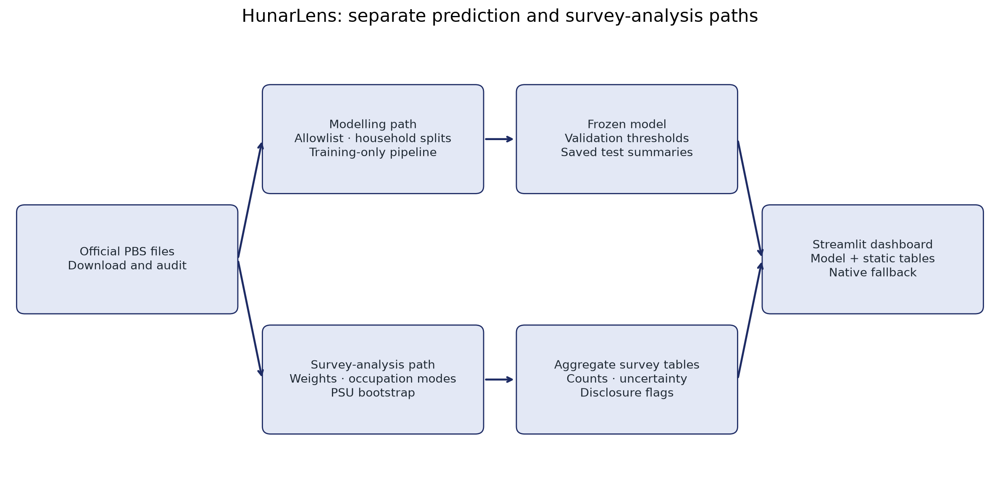

Figure 1 shows how both paths reach the dashboard through stored artefacts. The app loads the frozen pipeline and metadata for profile predictions, while the survey and performance pages read tracked aggregate tables. The presentation layer does not refit the model or perform a fresh test evaluation. This design makes the app small enough for straightforward deployment and keeps expensive research computations separate from interactive use.

The separation also makes evidence easier to audit. A chart about education mismatch can be traced to its survey table and bootstrap method; a probability can be traced to the saved preprocessing pipeline and model. A display correction should not change either analytical result. Keeping tables, presentation and inference distinct therefore supports reproducibility and gives the team a clear explanation of which component is responsible when an output looks unexpected.

### 3.2 Dashboard design and user needs

The Overview page introduces the population and official context. Skills gap supports comparisons of education outcomes, occupational placement and approximate NEET. Profile explorer illustrates the frozen model for a coherent set of allowed inputs. Model performance shows the baseline, uncertainty and subgroup errors. Data and methodology explains definitions, sources and responsible use. The navigation follows the questions a reader is likely to ask rather than exposing the order in which the code was written.

The profile display pairs the probability with the training base rate, a frequency description and a grid representing a hundred comparable observations. These representations offer alternatives to an isolated decimal. They remain illustrations of the same estimate, not additional observations or a promise about a particular person. The ruler's percentile is relative to validation scores, whereas the displayed probability describes the model's estimate; these are different quantities and need different labels.

Input controls use readable survey labels, grouped personal, education, location and household fields, and explanatory help text. Invalid household relationships or incompatible literacy answers block an estimate. Plausible but rare combinations produce a warning. Reference profiles and an input explorer reduce the effort needed to understand the interface, while explicit messages make clear when a hypothetical comparison may be poorly supported by the sample.

Accessibility includes labelled controls, visible focus, readable contrast, text alongside colours and a native Streamlit fallback. The design is informed by WCAG guidance (W3C, 2024), but the project does not claim formal conformance certification. The application does not persist or log profile inputs. Statistical counts shown elsewhere are aggregate evidence from the source survey, not records of visitors' use.

## 4. Design decisions and reasons

Table 1 summarises the main choices. The following subsections explain their consequences for validity and interpretation.

**Table 1. Decisions, alternatives and supporting evidence.**

| Decision | Alternatives considered | Choice and reason | Evidence |
| --- | --- | --- | --- |
| Labour-force label | Search alone; reported status; audited routes | Work, absence, search and availability routes with an explicit future-starter approximation | Label reproduction and future-starter diagnostics |
| Study population | All youth; labour-force youth | Labour-force youth for prediction; all youth for approximate NEET | Row waterfall and population definitions |
| Predictors | Broad survey fields; explicit allowlist | Demographic, education, roster and Census inputs; exclude outcome information | Feature audit and single-feature scan |
| Partitioning | Individual random split; household grouping | Keep related youth together in partitions and CV folds | Saved split summary and overlap tests |
| Geography | District linkage; province context | Verified province join; recognise constant Census features | Census lookup and feature ablation |
| Imbalance | Resampling; class weights; threshold adjustment | Compare weights, retain unweighted HGB and validation thresholds | Experiment comparison |
| Model selection | Largest CV score; pre-agreed simplicity tie rule | HGB within the tie band, with smaller train–CV gap and compact deployment | CV fold scores and gap table |
| Probability calibration | Raw probabilities; sigmoid mapping | Raw probabilities; validation Brier improvement was negligible | Calibration comparison |
| Operating points | Default cutoff; isolated F1 maximum; plateau midpoint | Validation midpoint plus recall-oriented alternative | Threshold table and documented midpoint limitation |
| Evaluation | Repeated test comparisons; frozen evaluation | Score the frozen pipeline once; reuse stored summaries | Test metrics and bootstrap intervals |
| Explanation | Individual importance alone; grouped information | Whole-pipeline permutations, correlated groups and ablation | Permutation and enrolment-ablation tables |
| Interface | Personal verdict; contextual exploration | Plain language, frequencies, uncertainty and non-decision wording | Dashboard, fallback and parity tests |
| Skills analysis | Direct skill claims; education proxies | Weighted attainment and occupational mismatch with resampled norms | Skills methods, reproduction and sensitivity tables |

### 4.1 Label definition and future starters

The label follows the approved employment and unemployment derivation rather than a single reported-status field. Paid or profit-oriented work and qualifying family work count as employment; own-use-only agricultural production does not. Temporary absence requires the audited return-to-work or continued-income routes. Unemployment normally requires no employment, recent search and current availability. This avoids treating every person without observed work as unemployed (PBS, n.d.-a, n.d.-b).

The future-starter exception includes available people who did not search because a job or business was arranged to begin soon. ILO guidance recognises such an exception but limits it to a short subsequent period, generally no more than three months (ILO, 2013, 2019). The survey does not supply a verified start date. The implementation therefore uses the questionnaire's near-future response as an approximation and states that timing compliance cannot be established for each person.

The future-starter diagnostic records 131 additional observations with weighted count 96,806. People waiting to start a new job are not classified as already employed. Among 50 such absence responses, weighted 41,977, the approved unemployment routes classify 27 as unemployed, weighted 21,809. These counts document the consequence of the rule; the rule was justified from the definition before numerical agreement was considered.

### 4.2 Questionnaire and file-label disagreement

The absence-reason variable S5C5 contains a disagreement between questionnaire categories and attached Stata labels. Several labels appear shifted, and an observed category lacks a reliable label. Blindly trusting the file would misinterpret waiting to start a new job as a reason for absence from an existing job. That would affect both employment status and the unemployment denominator.

The audit compared the category lists and inspected age and sex distributions among temporarily absent workers. The suspected maternity comparison was too sparse to resolve the mapping alone. The waiting-to-start code included 32 youth, compared with 3 in the next category, consistent with the questionnaire's distinction between new starters and illness-related absence. The team retained questionnaire coding and removed ambiguous absence responses. This is empirical support for a documented decision, not proof that every questionnaire route is measured without error.

### 4.3 Reproduction before modelling

The approved derivation yields weighted employed, unemployed and labour-force totals of 77.233, 5.897 and 83.130 million respectively, with unemployment 7.1%. These agree with the rounded PBS headline figures within the approved tolerances. The youth reproduction gives 12.8% and also checks sex and area comparisons. Reproduction is important because a classifier could otherwise learn a consistent but incorrectly constructed outcome.

The reproduction checks do not establish that the survey's complete production algorithm has been recovered. Rounded published totals can conceal small routing differences, and the future-starter timing limitation remains. The report consequently treats agreement as corroboration. It does not tune absence rules or exceptional categories to obtain a preferred total, and it distinguishes historical diagnostic attempts from the approved rule used in the current dataset.

### 4.4 Feature allowlist and leakage review

The predictor set is an explicit allowlist of 19 fields. Employment, occupation, industry, wages, search and availability variables are excluded even when they might produce strong prediction. The outcome is derived from such information, so including it would partly ask the model to rediscover the label rule. Identifiers, weights, survey timing and administrative status fields are also excluded as predictors.

A training-only grouped single-feature scan fits a shallow decision tree separately for each input. Its highest average precision is 0.168, and no input exceeds the specified multiple-of-prevalence warning threshold. This check complements schema tests and source review; it cannot certify the absence of every possible information shortcut. Enrolment receives additional scrutiny because its predictive association is strong despite being a roster field rather than a label input.

### 4.5 Household grouping and Census context

The full-roster household key combines processing code, enumeration block and household number, without quarter. The audited 53,974 groups match the published household count (PBS, n.d.-a). Individual random splitting was rejected because related young people share household circumstances. A household must remain wholly within a partition and within a cross-validation holdout. The unusually large observed roster groups remain a documented caveat about possible identifier reuse.

Census linkage uses verified province-level context with the app lookup retaining the province and area keys. It does not infer districts from unrelated residence fields. In this build, density, urban proportion and average household size are constant within province. They therefore add no new geographic information beyond province, although alternative numeric representations can affect a fitted estimator. Ablation and joint geographic permutation examine this redundancy rather than treating the indicators as independent local measurements.

### 4.6 Class weights and operating thresholds

Class weights were compared with unweighted fitting. For HGB, default grouped-CV AP is 0.297 without weights and 0.283 with balanced weights. The logistic and forest comparisons likewise do not justify class weighting as a universal improvement. Weights can alter ranking and calibration; a better F1 at the default cutoff does not necessarily mean a better probability model.

The chosen approach retains unweighted fitting and adjusts the operating threshold using validation data. This separates ranking quality from the decision rule used to calculate precision and recall. Undersampling was omitted because the approved comparisons already address imbalance without a new dependency or discarded majority records. The consequence is a simpler reproducible pipeline, accompanied by explicit trade-offs rather than a claim that class imbalance has been solved.

### 4.7 Model choice within the tie rule

Random Forest has the highest mean CV AP, 0.308, compared with HGB 0.298. Their unrounded difference lies just below the pre-agreed one-hundredth tie margin; the displayed difference rounds to 0.010. The team selected HGB within that margin, citing its smaller training-to-CV gap, compact model file and practical prediction speed. The gaps are 0.104 for HGB and 0.166 for the forest.

The selected compressed artefact measures 130.329 KiB. A comparable saved forest size and controlled latency benchmark are not available in the aggregate evidence, so no numeric size or speed ratio is claimed. Random Forest was marginally ahead on the reported validation metrics, but it was never evaluated on test. The tie-break is thus a documented engineering judgement supported by CV proximity, not a claim that HGB won every metric.

### 4.8 Calibration, thresholds and risk bands

Raw validation probabilities have Brier score 0.100, while sigmoid calibration has 0.100 at report precision. The unrounded improvement is negligible; both values round alike. The fixed-bin calibration error changes from 0.012 to 0.009. The team kept raw probabilities because the comparison did not clearly justify a calibration layer fitted to the same validation labels.

The primary threshold is the midpoint between the outer thresholds whose validation F1 is near its maximum. The stored primary and screening cutoffs display as 0.183 and 0.154. A discontinuous F1 curve means the midpoint need not itself remain in the qualifying set: its validation F1 is 0.354, compared with the original maximum 0.359. This limitation is retained rather than obscured by calling the midpoint exactly optimal.

High and Elevated bands begin at displayed probabilities 0.269 and 0.159. They derive from validation score quantiles, with High representing the upper decile and Elevated the next portion. Equal scores may change realised band sizes. The app uses full stored precision and calls the remaining band Lower than most. A relative band is not a guarantee of safety, and a follow-up flag is not a verdict.

### 4.9 Evaluation, explanation and application

The model, calibration choice and operating thresholds were frozen before test scoring. Only the frozen HGB and stratified Dummy were evaluated on test. Later performance views consume saved summaries, preserving the distinction between development evidence and final evaluation. This policy prevents repeated comparisons from turning the nominally held-out partition into another tuning sample.

Explanations use validation permutation importance through the whole pipeline, with correlated columns also permuted jointly. Geography is moved as one internally consistent tuple, while sex is separately reported. Education combines qualification and literacy. This reduces misleading interpretations of redundant fields, although permutation can still create unusual combinations with other inputs. The enrolment ablation provides complementary evidence about performance when a field is absent during fitting.

Application decisions follow the same caution. The profile tool validates coherent input combinations, warns about rare survey support, reports the population base rate and keeps non-decision wording close to the estimate. The native fallback provides the same conceptual content if the custom interface fails. These choices make the analysis easier to inspect without adding a new prediction method inside the UI.

### 4.10 Skills-gap estimation

Statistical mismatch compares each employed youth's education band with the weighted modal band in the occupation group. Reference populations include all employed adults, mid-age employed adults and employed youth. The mid-age norm happens to have the same point modes as the all-adult norm, so it is not an independent point-estimate sensitivity. A normative occupation-to-education mapping answers a different question and is reported separately.

PSU-cluster resampling re-estimates occupational modes inside every statistical mismatch replicate. Holding modes fixed would ignore uncertainty about the reference classification, particularly where education categories are nearly tied. The normative comparison keeps its rules fixed because those rules are definitions rather than estimated modes. Reproduction checks compare weighted occupation shares, education distribution and age-eligible education unemployment rates against published PBS tables. The largest recorded absolute difference is 0.055 percentage points.

## 5. Data and preparation

### 5.1 Sources and analytical populations

The source inventory in [DATA_SOURCES.md](../DATA_SOURCES.md) identifies the official LFS microdata, questionnaire, coding scheme and Annual Report, together with Census workbooks and methodological references. The questionnaire provides wording and routing; the coding scheme supports category interpretation; the Annual Report supplies definitions and published checks. Census context supplies geographic aggregates. None of these roles is interchangeable: a convenient variable label is not by itself a verified statistical definition.

The modelling population is youth aged fifteen through twenty-four classified as employed or unemployed. The broader survey-analysis dataset retains other eligible ages for occupational reference norms and all youth for approximate NEET. Counts are unweighted sample sizes unless explicitly described as weighted totals. This separation matters because survey weights expand observations to different population totals and because an occupational denominator excludes unemployed people.

### 5.2 Row waterfall and privacy

The raw roster contains 325,445 records. After excluding the ambiguous absence category, 325,428 remain; after excluding temporarily absent workers without a recorded reason, 325,420 remain. The age-eligible national reproduction population contains 230,760 records. Youth filtering retains 59,486, and restricting those youth to the labour force gives 26,653 modelling records. This sequence records losses explicitly rather than silently dropping inconsistent rows.

Household size, children and other youth are calculated before the youth restriction. Otherwise a household would appear to contain only its selected young workers. Head's characteristics likewise come from the household roster. The source name field and address, phone or identity fields are removed from analytical exports. Group keys are retained only where grouping is required and are never displayed as predictors or as notebook examples.

Raw and person-level files remain local and ignored by version control. The application needs only the frozen model, metadata, small geographic lookup, rarity flags, score quantiles and aggregate results. Redistribution permission is not inferred from download availability. This boundary helps protect survey respondents and reduces the risk that the deployed interface or submission package exposes records irrelevant to its purpose.

## 6. Exploratory data analysis

The EDA describes the unweighted modelling records. It is intended to reveal imbalance, uneven support, coding problems and plausible feature relationships before model comparison. It should not be read as an alternative official population release. The weighted survey path answers population questions separately, and its uncertainty estimates cannot simply be attached to unweighted charts.

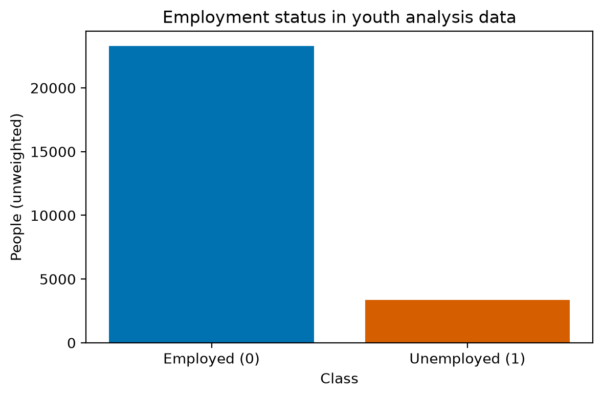

The positive class contains 3,383 observations, or 12.7% of 26,653 records. This explains why majority-class accuracy is an inadequate success criterion: a classifier can appear accurate while finding almost no unemployed youth. Average precision, recall and the Dummy baseline make that problem visible. The absolute number of positives also limits how finely subgroup performance can be estimated.

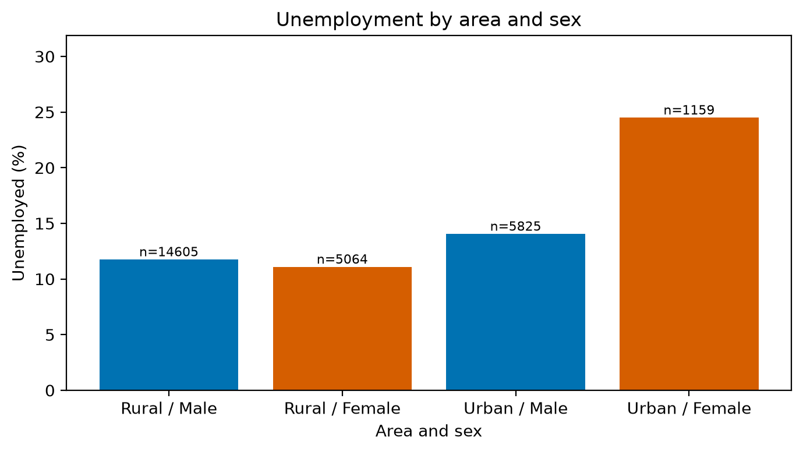

Urban women have the highest unemployment share in this descriptive comparison, while the rural female group is much closer to the male groups. The pattern motivates the sex–area interaction and a fairness review, but does not identify a causal effect of location or sex. Group counts and labour-force selection are essential context; the women included here are a selected subset of all young women.

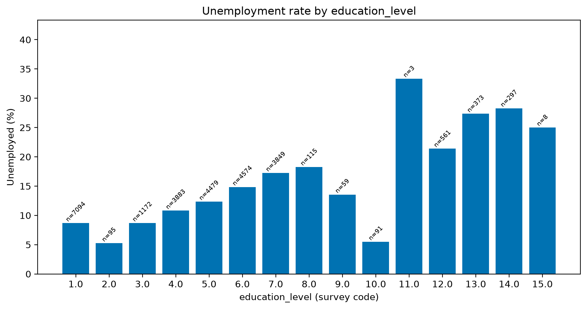

Education categories differ substantially in observed unemployment and in sample support. Fine qualification labels should not be interpreted as a smooth ladder with equally spaced distances. Some categories are rare and some degree labels describe course type rather than a higher attainment level. The broad-band skills analysis and the detailed model inputs therefore serve different purposes, and neither establishes the return to an additional qualification.

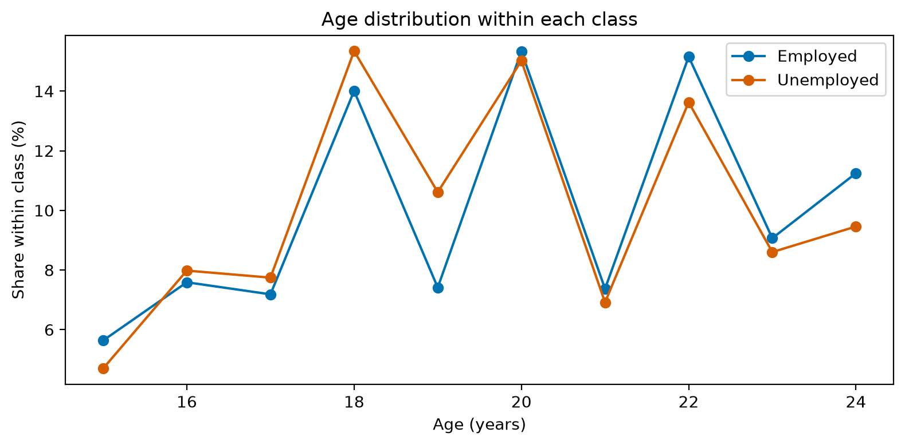

The age chart normalises within class so that the larger employed group does not dominate the comparison. Visible peaks may reflect reported ages and the composition of the labour-force sample. Age is retained numerically and also represented by broad bands inside the pipeline. A cross-sectional age pattern is not a trajectory showing how the same young people progress through employment.

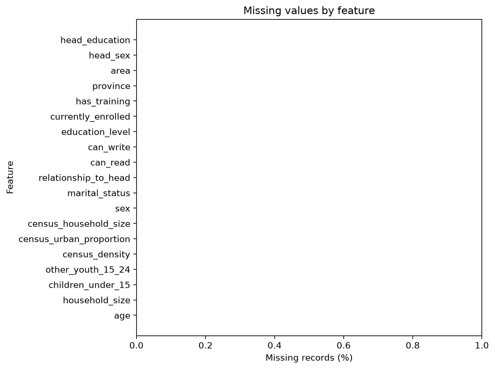

The largest observed feature missing rate is 0.0%. This refers to recognised missing values after the approved conversion rules, not proof that the underlying questionnaire is error-free. Substantive responses such as no formal education or not enrolled remain meaningful categories. Training timing is collapsed, and the unverified training-type field is excluded. Imputation remains in the production pipeline to give consistent behaviour for valid missing values in later input.

## 7. Methodology

### 7.1 Inputs and preprocessing

**Table 2. The 19 allowed raw input features, grouped by purpose.**

| Group | Input features | Meaning and handling |
| --- | --- | --- |
| Person | Age; sex; marital status; relationship to household head | Roster characteristics; age remains numeric, other fields categorical |
| Education and training | Can read; can write; education level; currently enrolled; has training | Verified categories; training collapsed to ever/current versus never |
| Location | Province; urban/rural area | Broad geography; no district matching or outcome-derived regional rate |
| Household | Household size; children under fifteen; other youth; head's sex; head's education | Built from the full household roster before filtering youth |
| Census context | Population density; urban proportion; average household size | Regional aggregates; constant within province in this implementation |

The pipeline begins with approved feature engineering and then applies a column transformer. Numeric features receive median imputation and standard scaling; categorical features receive most-frequent imputation and unknown-safe one-hot encoding. Infrequent categories are grouped according to the configured minimum frequency. All learned transformations are fitted only to the relevant training fold and reused for its holdout. The app calls this same fitted pipeline rather than reproducing preprocessing independently.

Engineered inputs include the education-code representation alongside the categorical qualification, broad age bands, children as a share of household size, a household-size upper clip learned from training, and a sex–area interaction. The education-code representation is a pragmatic ordering, not a claim that all qualifications have equal spacing or that adjacent degree types imply a strict skill ranking. Keeping the categorical input allows additional distinctions. The learned clipping limit is recalculated within training folds, preventing full-dataset distribution information from entering preprocessing.

### 7.2 Household partitions and cross-validation

**Table 3. Saved household-grouped partitions.**

| Partition | Youth n | Unemployed n | Prevalence |
| --- | --- | --- | --- |
| test | 3,999 | 508 | 12.7% |
| train | 18,657 | 2,368 | 12.7% |
| val | 3,997 | 507 | 12.7% |

The partition procedure uses shuffled stratified household folds with a fixed random seed, allocating most folds to training and equal smaller sets to validation and test. The saved assignments are reused by experiments. Stratification balances the outcome as far as household grouping allows; exact equality is neither necessary nor guaranteed. Household membership, rather than each individual record, is the unit that must stay intact.

Model selection uses five-fold stratified grouped cross-validation within training. Average precision is the refit metric and ROC-AUC is also recorded. Every fold fits the complete pipeline, including feature engineering and encoding. Validation is then used for reported model comparisons, threshold selection and calibration review. The final test partition is not used to choose inputs, hyperparameters, explanatory groups or application behaviour.

### 7.3 Models, search and generalisation

The stratified Dummy supplies a random-prediction reference aligned with training class balance. Logistic regression provides a comparatively simple linear predictor, Random Forest represents interactions through bagged trees, and histogram gradient boosting builds additive tree corrections. Default, weighted and tuned variants separate the effects of model family, imbalance handling and hyperparameters. The experiment table retains these comparisons rather than reporting only the best-looking validation result.

The logistic grid crosses regularisation strength with class-weight options. Forest search varies tree count, depth, minimum leaf size, feature subsampling and weights. HGB search varies learning rate, depth, leaf count, minimum leaf size, regularisation, iteration count and weights, with early stopping disabled. The implemented random searches use 15 forest candidates and 15 HGB candidates, fewer than the larger planned budgets, to keep grouped fitting practical on the available laptop. Appendix B records the exact search values and selected HGB parameters.

**Table 4. Tuned-model average precision and the training–CV gap.**

| Tuned model | Train AP | CV AP | Validation AP | Train minus CV |
| --- | --- | --- | --- | --- |
| Logistic regression | 0.289 | 0.281 | 0.281 | 0.008 |
| Random Forest | 0.473 | 0.308 | 0.328 | 0.166 |
| Histogram gradient boosting | 0.401 | 0.298 | 0.312 | 0.104 |

The forest and HGB fit training data more strongly than their held-out folds; the logistic gap is smaller but its CV ranking quality is lower. A larger training score alone is therefore not evidence of a better generalising model. Fold variability also matters: the models are compared on the same grouped folds, allowing paired comparisons rather than treating different resamples as equivalent experiments.

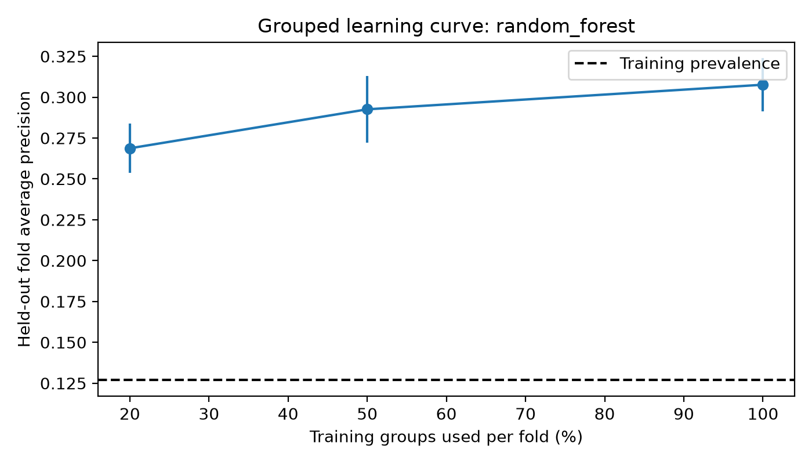

The saved learning curve belongs to Random Forest, not the eventual HGB selection. Its mean CV AP increases from 0.269 at the smallest training fraction to 0.308 at the largest. This suggests that additional training information may still help that model under this resampling design. It does not establish the learning curve of HGB or guarantee improvement with future survey data. The separate forest complexity curve examines sensitivity to maximum depth.

### 7.4 Evaluation and uncertainty

F1 balances precision and recall at an operating point, whereas AP summarises ranking across recall levels. ROC-AUC measures ranking over positive–negative pairs, and top-decile lift compares the concentration of unemployed observations in the highest-scored group with prevalence. Accuracy is retained for completeness but does not guide model selection. All model metrics are unweighted, reflecting the experimental record-based task.

Household bootstrap intervals resample test households with replacement, preserving within-household dependence. The saved calculation uses 1,000 repetitions. Percentile bounds describe variation under that resampling scheme; they do not represent uncertainty from retraining, the complete complex survey design or future economic conditions. Subgroup tables add denominators and positive counts, because a seemingly impressive recall based on very few unemployed observations can be highly unstable.

### 7.5 Explanation and survey estimation

Whole-pipeline permutation importance measures the AP decrease after an input or group is shuffled on validation. Error bars describe variation across permutations, not confidence intervals for a causal quantity. Correlated information may be shared across features, so small differences in importance are not treated as a ranking of social importance. Partial-dependence-style substitutions average predictions after setting a field to a common value and may create uncommon combinations.

The skills analysis instead uses LFS weights and PSU-cluster bootstrap intervals. Education is collapsed into broad bands, armed forces are excluded from the major-occupation comparison, and any unsupported lens is omitted rather than inferred. Industry, detailed field of study and unemployment barriers are not part of the final extension. The degree-type lens uses only explicitly identifiable questionnaire degree categories and retains its small-cell limitations.

Nonzero cells below the disclosure minimum are suppressed; structural impossibilities are marked with a dash. Unreliable groups carry a visible flag. When occupational modes frequently change across resamples or ranges become very wide, rows are labelled mode unstable and shown with their bootstrap range. An independent calculation checks headline agreement, while composition checks confirm that mutually exclusive outcomes sum to the full denominator before display rounding.

## 8. Results

### 8.1 Model comparison and final evaluation

**Table 5. Grouped CV and validation comparison; validation F1 uses each experimental tuned cutoff.**

| Model | CV AP | Fold SD | Validation AP | Validation F1 |
| --- | --- | --- | --- | --- |
| Stratified Dummy | 0.126 | 0.000 | 0.127 | 0.124 |
| Logistic regression | 0.281 | 0.012 | 0.281 | 0.327 |
| Random Forest | 0.308 | 0.016 | 0.328 | 0.373 |
| Histogram gradient boosting | 0.298 | 0.014 | 0.312 | 0.359 |

These validation thresholds were selected on the same labels used to report F1, so their F1 values are optimistic. The HGB experimental maximum is also distinct from the subsequently frozen midpoint. The forest leads the reported validation metrics; HGB is selected through the documented tie rule. The test table evaluates only the frozen choice and the baseline, preserving the original distinction between selection and assessment.

**Table 6. Test metrics and household-bootstrap intervals at frozen operating points.**

| Model / operating point | F1 [95% CI] | Precision [95% CI] | Recall [95% CI] | AP [95% CI] | ROC-AUC [95% CI] | Top-decile lift [95% CI] |
| --- | --- | --- | --- | --- | --- | --- |
| HGB F1 | 0.360 [0.328, 0.393] | 0.273 [0.245, 0.303] | 0.530 [0.485, 0.576] | 0.303 [0.267, 0.343] | 0.752 [0.731, 0.774] | 2.814 [2.450, 3.129] |
| HGB screening | 0.354 [0.326, 0.382] | 0.247 [0.223, 0.271] | 0.628 [0.584, 0.675] | 0.303 [0.267, 0.343] | 0.752 [0.731, 0.774] | 2.814 [2.450, 3.129] |
| Stratified Dummy | 0.123 [0.097, 0.154] | 0.125 [0.098, 0.156] | 0.122 [0.094, 0.152] | 0.127 [0.116, 0.139] | 0.499 [0.484, 0.515] | 0.866 [0.747, 1.240] |

The test sample contains 3,999 records and 508 unemployed observations, giving prevalence 12.7%. HGB's AP 0.303 is meaningfully above Dummy AP 0.127, while its F1 0.360 exceeds Dummy F1 0.123. The F1 interval is 0.328–0.393 and the AP interval is 0.267–0.343. These results show useful concentration of survey outcomes, alongside substantial errors and uncertainty.

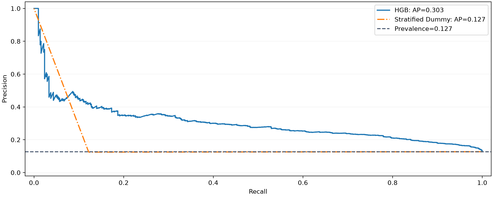

At the primary cutoff the model correctly flags 269 unemployed people and misses 239. It flags 716 employed people, while 2,775 employed people remain unflagged. Precision 27.3% means that most flags are not unemployed observations in this sample. Recall 53.0% means that a substantial share of unemployed people are missed. These counts make the limitations more concrete than a summary score alone.

The screening cutoff finds 319 unemployed people, with recall 62.8%, but flags 975 employed people and has precision 24.7%. This is an operating trade-off rather than a universally preferable setting. Top-decile lift is 2.814, compared with 0.866 for the Dummy; top-fifth lift is 2.273. Ranking enriches the selected group, but enrichment does not justify using the group for individual decisions.

### 8.2 Subgroup errors and fairness

Primary recall is 68.0% among females and 48.0% among males, with 125 and 383 unemployed observations respectively. Their flagged shares are 26.8% and 24.0%. A common threshold intersects different group score distributions, so equal cutoffs do not imply equal recall. This describes a threshold-dependent performance difference; it is not a causal explanation of sex differences in unemployment or a demonstration of fairness.

Recall is 17.9% for people without formal education, based on 95 unemployed people among 1,038 records. For intermediate education it is 94.1%, based on 101 unemployed people among 617 records. The contrast shows how a model with acceptable overall ranking can systematically miss an important subgroup. Degree-or-higher performance rests on only 46 positives among 208 records and is flagged as unreliable.

The error analysis compares feature distributions for false negatives with true positives and false positives with true negatives. These are counts, so large groups can dominate even when their error rate is moderate. Both rate and count perspectives are needed: one describes unequal performance, the other the number of affected observations. The complete subgroup table in Appendix A supports examination beyond the selected examples in this narrative.

### 8.3 Importance, enrolment and ablation

Grouped AP importance is 0.111 for education, 0.082 for enrolment, 0.062 for geography and 0.047 for sex. These are model-reliance measures under permutation. They do not imply that changing a person's category would produce a corresponding change in employment. Removing enrolment during grouped HGB fitting changes CV AP from 0.298 to 0.250, demonstrating substantial predictive reliance on that field.

Among training records, 73 of 2,172 enrolled youth are unemployed, a rate of 3.4%, compared with 2,295 of 16,485 not-enrolled youth, or 13.9%. The average substituted model profile also gives lower probabilities to enrolled categories. A plausible hypothesis involves labour-force selection and the search and availability rules: enrolled people who appear in this sample are largely working. The association must not be generalised to students outside the sample.

### 8.4 Education outcomes and graduate placement

**Table 7. Weighted youth unemployment within the labour force, with sample counts and PSU-bootstrap bounds.**

| Population / norm | Outcome / education | Denominator n | Cell n | Weighted share | Lower bound | Upper bound | Disclosure / reliability |
| --- | --- | --- | --- | --- | --- | --- | --- |
| Overall | No formal | 7,094 | 617 | 8.2% | 7.3% | 9.0% |  |
| Overall | Below matric | 9,629 | 1,080 | 11.4% | 10.6% | 12.2% |  |
| Overall | Matric | 4,574 | 679 | 14.8% | 13.7% | 16.0% |  |
| Overall | Intermediate | 3,849 | 664 | 17.5% | 16.1% | 19.1% |  |
| Overall | Degree or above | 1,507 | 343 | 22.6% | 20.3% | 25.0% |  |

The gradient across the broad education bands persists as a descriptive pattern, but the same denominators also support employed-at-mode, employed-above-mode, employed-below-mode and unemployed shares. Those mutually exclusive outcomes are reproduced in Appendix A. Some mismatch-related intervals are asymmetric because resampled occupational modes alter the classification; ordinary unemployment rates do not depend on those modes. The distinction prevents a single uncertainty explanation from being incorrectly applied to every column.

Graduate absorption separates employment in managerial, professional, technical and clerical groups (42.0%) from employment in the remaining major groups (35.4%) and unemployment (22.6%). These categories describe placement among degree-level labour-force youth, not the availability of graduate vacancies. Their full weighted shares, sample counts and intervals appear in Appendix A, alongside sex and area comparisons. A graduate in a lower major group is not automatically shown to have unusable skills or a poor-quality job.

### 8.5 Mismatch depends on definition

Strict above-mode shares range from 41.0% under the youth reference to 46.0% under the all-adult reference. The adult estimate has interval 45.0%–47.2% with denominator 23,270. The youth estimate has interval 31.1%–41.6% with the same denominator. Its point estimate lies near the upper end because some bootstrap samples select alternative occupational modes, moving many youth into different mismatch categories.

Under the within-one-band definition, 75.7% are matched within tolerance, with interval 74.8%–76.5%. The severe above-mode definition gives 19.8%, with interval 19.1%–20.8%. The normative above-level share is 10.6%, with interval 10.1%–11.1% and denominator 23,270. These definitions are deliberately kept separate; combining them into a single range would disguise the questions being compared.

Agricultural and elementary occupations have low modal education, making the strict above-mode share sensitive to occupational composition and the coarse band scheme. This result is not a count of wasted degrees or proof of deficient workers. The by-occupation tables label mode unstable rows and show the bootstrap range. The accompanying stability table records how often each band is selected, making uncertainty in the reference classification visible rather than burying it inside a narrow-looking interval.

### 8.6 Training, approximate NEET and illustrative shifts

Training ever/current is reported by 10.6% of unemployed youth and 19.5% of employed youth. It is 8.9 percentage points lower among unemployed than employed youth, with a difference magnitude interval of 7.5–10.3 percentage points. The comparison cannot isolate a training effect: training can occur during employment, and timing categories were deliberately discarded to form the permitted indicator.

The not-employed-and-not-enrolled approximation is 29.3%, with interval 28.7%–29.8%, denominator 59,486 and cell count 18,007. PBS reports 28.4% for national youth NEET. Our approximation is not the complete SDG indicator because recent training cannot be identified. Sex and area results appear in Appendix A; they describe broader exclusion from work and enrolment than the labour-force-only unemployment classifier.

The education-profile substitution covers 3,268 validation records, corresponding to 82.1% weighted coverage. Its average model-estimated difference is 3.6 percentage points, with code-choice sensitivity 3.2–3.8. The calculation averages valid next-band codes using training frequencies and excludes invalid or rare combinations. This is a model-estimated difference within the labour-force sample, affected by selection, not an educational intervention effect. Low-education employment is concentrated in agricultural and elementary occupations, and many low-educated women are outside the labour force.

## 9. Deployment and verification

**Live application:** [TEAM TO INSERT SUBMISSION URL]

Streamlit hosts the interface and caches the model and metadata resources. The entry point resolves repository-relative paths and imports the package containing the custom transformer before unpickling. Tracked assets supply category labels, geographic context, rarity flags, quantiles and displayed result tables. The custom dashboard component communicates with the Python application for prediction; the native fallback retains usable tables and controls if that component cannot render (Streamlit, n.d.).

Application testing checks loading, navigation, invalid-input handling and the agreement of app predictions with pipeline probabilities for valid profiles. It also checks category coercion so equivalent coded values produce the same input representation, and unknown categories raise a clear error. Household-head consistency and rarity warnings are tested separately. These checks complement model tests; a statistically frozen artefact does not by itself prevent a UI mapping or input-type bug.

The report uses the saved screenshots below to document the desktop pages and representative phone layouts. They illustrate navigation and presentation rather than serving as the source of statistical values. Tables and report prose draw from saved numerical evidence. Responsive presentation keeps the same definitions across screen sizes; it should not introduce different calculations for mobile visitors.

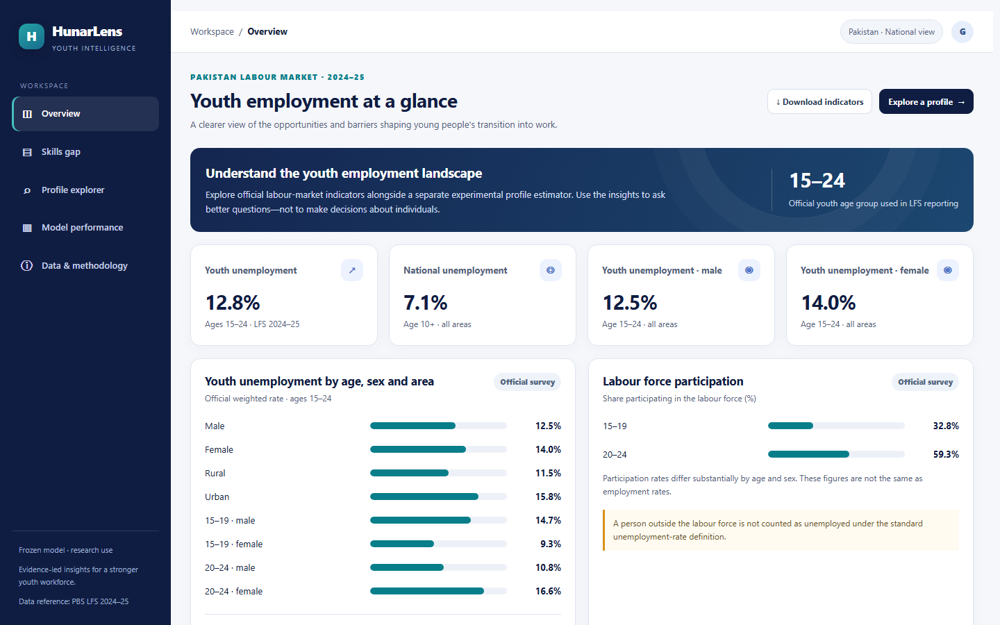

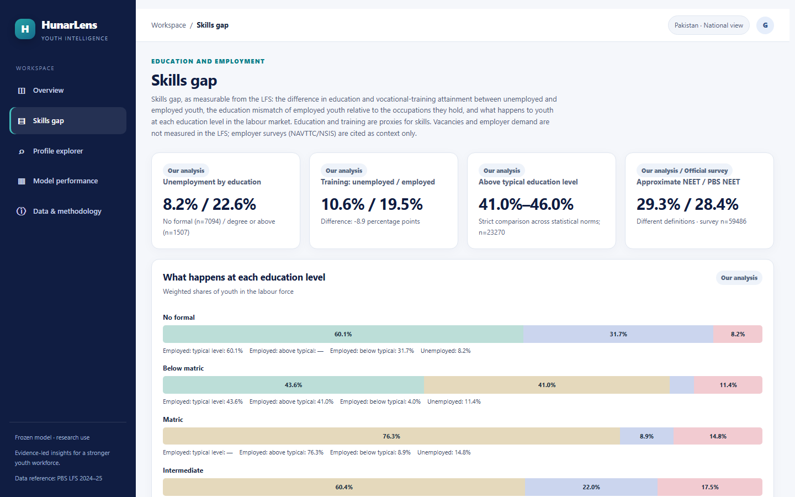

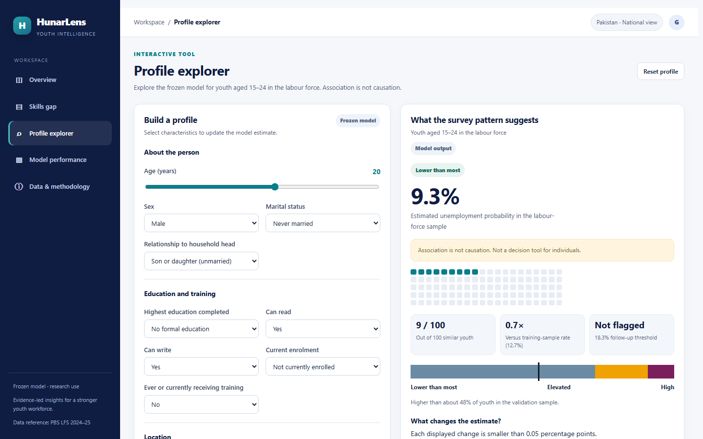

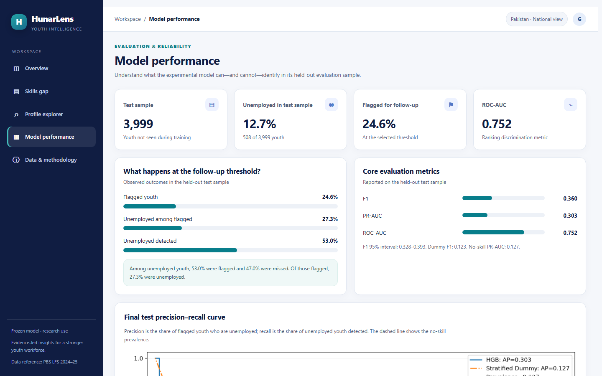

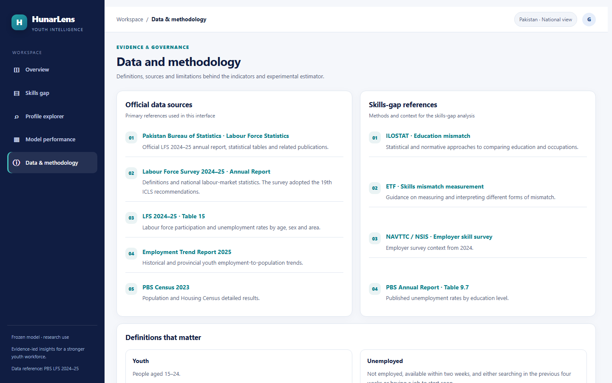

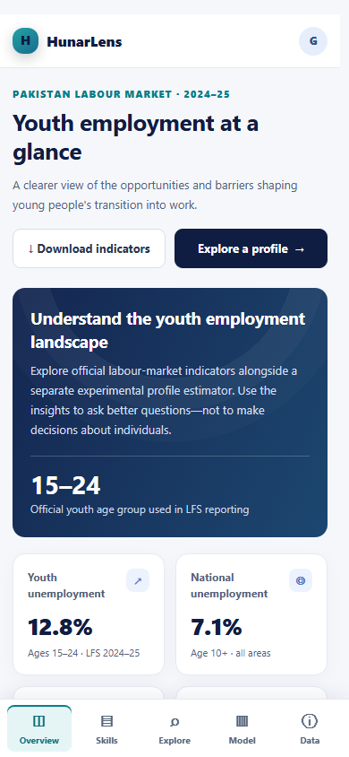

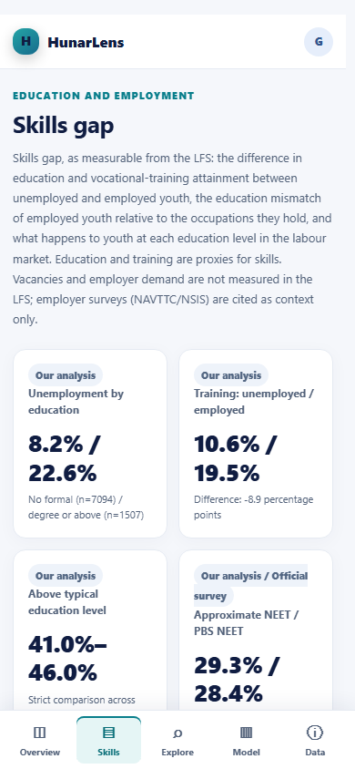

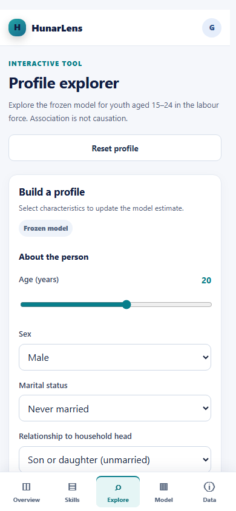

## 10. Limitations and future work

The modelling analysis is unweighted and limited to the labour force. Its probabilities describe the fitted sample relationship rather than a representative risk for every young person in Pakistan. The future-starter timing condition cannot be checked. Household grouping reduces related-record leakage but depends on the approved key, whose unusual large groups deserve further validation. An external survey or later observation period would provide stronger evidence of transportability than further reuse of the held-out sample.

Census indicators are coarse and constant within province. They cannot represent neighbourhood opportunities or changes between the Census and survey periods. Education bands and major occupations also compress important variation. The ordinal education-code feature is a modelling convenience, and the statistical mode is a description of workers, not a direct requirement imposed by employers. Vacancy data, skill assessments and job-quality measures would be needed for stronger claims about labour-market matching.

PSU bootstrap intervals acknowledge clustering but omit stratification and other elements of the complete survey design. Re-estimating modes captures classification uncertainty within this approximation, yet unstable occupational modes remain sensitive to sample composition. Disclosure suppression protects small observed cells but also limits the specificity of conclusions. Point estimates and their intervals should be read with the reference population, reliability flag and weighting method together.

Fairness remains an empirical and normative question. Sex and geography are inputs, subgroup recall differs markedly, and calibration can vary across combinations. Future work should assess external calibration, subgroup error uncertainty and intended-use harms with domain stakeholders. Removing a sensitive input alone would not guarantee fairness because correlated information remains. No individual decision use is justified by the current evaluation, even if aggregate predictive scores improve.

## 11. Use of AI assistance

**TEAM TO COMPLETE ACCORDING TO COURSE POLICY:** Describe the AI tools used, the tasks for which assistance was received, the material independently checked, and how each member verified and understood the submitted work. Include the course's required disclosure wording and any restrictions that applied. The team remains responsible for the correctness, originality, interpretation and defensibility of the submission.

## 12. Individual contributions

**Table 8. Individual contributions for completion by the team.**

| Member | Student identifier | Implementation and analysis | Writing and verification |
| --- | --- | --- | --- |
| Sarim Khan | CT-24266 | [TEAM TO COMPLETE] | [TEAM TO COMPLETE] |
| Muhammad Saraib | CT-24255 | [TEAM TO COMPLETE] | [TEAM TO COMPLETE] |
| Danish Meraj | CT-24268 | [TEAM TO COMPLETE] | [TEAM TO COMPLETE] |

## References

- European Training Foundation. (2019). *Skills mismatch measurement in ETF partner countries*. https://www.etf.europa.eu/en/publications-and-resources/publications/skills-mismatch-measurement-etf-partner-countries (accessed November 20, 2026).
- International Labour Organization. (2013). *Resolution concerning statistics of work, employment and labour underutilization*. Nineteenth International Conference of Labour Statisticians. https://www.ilo.org/resource/resolution-concerning-statistics-work-employment-and-labour-0 (accessed November 20, 2026).
- International Labour Organization. (2019). *Variable derivation guide for ILO Model LFS Questionnaire for PAPI: Approach 1, version 2*. https://webapps.ilo.org/ilostat-files/LFS/ILO_PAPI_LFS_VARIABLE_DERIVATION_GUIDE%20%28A1V2%29.pdf (accessed November 20, 2026).
- International Labour Organization. (2021, September 17). *Only half of workers worldwide hold jobs corresponding to their level of education*. ILOSTAT. https://ilostat.ilo.org/blog/only-half-of-workers-worldwide-hold-jobs-corresponding-to-their-level-of-education/ (accessed November 20, 2026).
- National Vocational and Technical Training Commission. (n.d.). *National Skills Information System*. https://www.skillingpakistan.gov.pk/ (browser access confirmed by the team; accessed November 19, 2026).
- Pakistan Bureau of Statistics. (n.d.-a). *Labour Force Survey 2024–25: Annual report*. https://www.pbs.gov.pk/wp-content/uploads/2020/07/LFS-2024-25-Annual-Report.pdf (accessed November 20, 2026). [VERIFY: publication year; the survey period is confirmed but is not necessarily the publication year.]
- Pakistan Bureau of Statistics. (n.d.-b). *Questionnaire of Labour Force Survey 2024–25*. https://www.pbs.gov.pk/wp-content/uploads/2020/07/Questionnaire-of-LFS-2024-25-Final.pdf (accessed November 20, 2026). [VERIFY: publication year.]
- Pakistan Bureau of Statistics. (n.d.-c). *Labour Force Survey 2024–25 coding scheme and microdata*. https://www.pbs.gov.pk/labour-force-statistics/ (accessed November 20, 2026). [VERIFY: publication year of the individual files.]
- Pakistan Bureau of Statistics. (n.d.-d). *Population and Housing Census 2023: Detailed results, Table 1 workbooks*. https://www.pbs.gov.pk/result-excel/ (accessed November 20, 2026). [VERIFY: workbook publication date; census reference year is confirmed.]
- Pedregosa, F., Varoquaux, G., Gramfort, A., Michel, V., Thirion, B., Grisel, O., Blondel, M., Prettenhofer, P., Weiss, R., Dubourg, V., Vanderplas, J., Passos, A., Cournapeau, D., Brucher, M., Perrot, M., & Duchesnay, É. (2011). Scikit-learn: Machine learning in Python. *Journal of Machine Learning Research, 12*, 2825–2830. https://jmlr.org/papers/v12/pedregosa11a.html
- Shah, S. A., & Khan, M. Z. (n.d.). *Skills trend analysis: National & international*. National Vocational and Technical Training Commission. https://tevtreform.jobs.gov.pk/wp-content/uploads/downloads/governance/Skills%20Trend%20Analysis.pdf (accessed November 20, 2026). [VERIFY: publication date and the reference periods of its constituent surveys before quoting any demand statistic.]
- Streamlit. (n.d.). *Streamlit documentation*. https://docs.streamlit.io/ (accessed November 20, 2026).
- World Wide Web Consortium. (2024, December 12). *Web Content Accessibility Guidelines (WCAG) 2.2*. https://www.w3.org/TR/2024/REC-WCAG22-20241212/ (accessed November 20, 2026).

## Appendix A. Full results and uncertainty

### Table A1. Unemployment by education

| Population / norm | Outcome / education | Denominator n | Cell n | Weighted share | Lower bound | Upper bound | Disclosure / reliability |
| --- | --- | --- | --- | --- | --- | --- | --- |
| Overall | No formal | 7,094 | 617 | 8.2% | 7.3% | 9.0% |  |
| Overall | Below matric | 9,629 | 1,080 | 11.4% | 10.6% | 12.2% |  |
| Overall | Matric | 4,574 | 679 | 14.8% | 13.7% | 16.0% |  |
| Overall | Intermediate | 3,849 | 664 | 17.5% | 16.1% | 19.1% |  |
| Overall | Degree or above | 1,507 | 343 | 22.6% | 20.3% | 25.0% |  |
| Male | No formal | 4,669 | 468 | 9.2% | 8.1% | 10.3% |  |
| Male | Below matric | 8,076 | 925 | 11.7% | 10.8% | 12.6% |  |
| Male | Matric | 3,856 | 529 | 13.9% | 12.6% | 15.3% |  |
| Male | Intermediate | 2,916 | 439 | 15.4% | 13.9% | 16.9% |  |
| Male | Degree or above | 913 | 176 | 18.6% | 15.8% | 21.4% |  |
| Female | No formal | 2,425 | 149 | 6.1% | 4.9% | 7.6% |  |
| Female | Below matric | 1,553 | 155 | 10.1% | 8.5% | 11.9% |  |
| Female | Matric | 718 | 150 | 19.5% | 16.3% | 22.8% |  |
| Female | Intermediate | 933 | 225 | 23.5% | 20.3% | 26.7% |  |
| Female | Degree or above | 594 | 167 | 28.4% | 24.5% | 32.0% |  |
| Rural | No formal | 5,986 | 494 | 7.4% | 6.4% | 8.4% |  |
| Rural | Below matric | 7,212 | 719 | 9.8% | 8.9% | 10.6% |  |
| Rural | Matric | 3,129 | 456 | 14.6% | 13.1% | 16.1% |  |
| Rural | Intermediate | 2,505 | 413 | 17.0% | 15.2% | 18.8% |  |
| Rural | Degree or above | 837 | 198 | 24.1% | 20.9% | 27.2% |  |
| Urban | No formal | 1,108 | 123 | 11.3% | 8.9% | 13.7% |  |
| Urban | Below matric | 2,417 | 361 | 15.2% | 13.5% | 16.9% |  |
| Urban | Matric | 1,445 | 223 | 15.3% | 13.1% | 17.6% |  |
| Urban | Intermediate | 1,344 | 251 | 18.2% | 15.6% | 20.9% |  |
| Urban | Degree or above | 670 | 145 | 21.2% | 17.6% | 24.6% |  |

Source: [skills_unemployment_by_education.csv](../reports/tables/skills_unemployment_by_education.csv). Bounds are PSU-bootstrap percentile bounds. Rows labelled mode unstable show the bootstrap range. A dash denotes a structural zero; n<30 denotes primary suppression.

### Table A2. Graduate absorption

| Population / norm | Outcome / education | Denominator n | Cell n | Weighted share | Lower bound | Upper bound | Disclosure / reliability |
| --- | --- | --- | --- | --- | --- | --- | --- |
| Overall | Employed: groups 1–4 | 1,507 | 624 | 42.0% | 39.3% | 44.7% |  |
| Overall | Employed: groups 5–9 | 1,507 | 540 | 35.4% | 33.0% | 37.9% |  |
| Overall | Unemployed | 1,507 | 343 | 22.6% | 20.3% | 25.0% |  |
| Male | Employed: groups 1–4 | 913 | 336 | 38.2% | 34.8% | 41.8% |  |
| Male | Employed: groups 5–9 | 913 | 401 | 43.2% | 39.7% | 46.6% |  |
| Male | Unemployed | 913 | 176 | 18.6% | 15.8% | 21.4% |  |
| Female | Employed: groups 1–4 | 594 | 288 | 47.3% | 43.2% | 51.6% |  |
| Female | Employed: groups 5–9 | 594 | 139 | 24.2% | 20.4% | 27.9% |  |
| Female | Unemployed | 594 | 167 | 28.4% | 24.5% | 32.0% |  |
| Rural | Employed: groups 1–4 | 837 | 321 | 39.2% | 35.7% | 42.6% |  |
| Rural | Employed: groups 5–9 | 837 | 318 | 36.7% | 33.5% | 40.3% |  |
| Rural | Unemployed | 837 | 198 | 24.1% | 20.9% | 27.2% |  |
| Urban | Employed: groups 1–4 | 670 | 303 | 44.7% | 40.3% | 49.2% |  |
| Urban | Employed: groups 5–9 | 670 | 222 | 34.1% | 30.0% | 38.1% |  |
| Urban | Unemployed | 670 | 145 | 21.2% | 17.6% | 24.6% |  |

Source: [skills_graduate_absorption.csv](../reports/tables/skills_graduate_absorption.csv). Bounds are PSU-bootstrap percentile bounds. Rows labelled mode unstable show the bootstrap range. A dash denotes a structural zero; n<30 denotes primary suppression.

### Table A3. Mismatch

| Population / norm | Outcome / education | Denominator n | Cell n | Weighted share | Lower bound | Upper bound | Disclosure / reliability | Bootstrap median | Bootstrap bias |
| --- | --- | --- | --- | --- | --- | --- | --- | --- | --- |
| Overall; norm=All employed adults | matched | 23,270 | 9,082 | 38.0% | 37.1% | 38.9% |  | 38.0% | -0.0% |
| Overall; norm=All employed adults | over | 23,270 | 10,516 | 46.0% | 45.0% | 47.2% |  | 46.0% | 0.0% |
| Overall; norm=All employed adults | under | 23,270 | 3,672 | 16.0% | 15.0% | 16.7% |  | 16.1% | 0.0% |
| Male; norm=All employed adults | matched | 17,893 | 6,627 | 36.5% | 35.7% | 37.5% |  | 36.5% | -0.0% |
| Male; norm=All employed adults | over | 17,893 | 8,721 | 49.1% | 48.1% | 50.5% |  | 49.2% | 0.0% |
| Male; norm=All employed adults | under | 17,893 | 2,545 | 14.3% | 13.1% | 15.0% |  | 14.3% | -0.0% |
| Female; norm=All employed adults | matched | 5,377 | 2,455 | 42.7% | 40.8% | 44.5% |  | 42.6% | -0.1% |
| Female; norm=All employed adults | over | 5,377 | 1,795 | 35.6% | 33.9% | 37.7% |  | 35.6% | 0.0% |
| Female; norm=All employed adults | under | 5,377 | 1,127 | 21.7% | 20.0% | 23.1% |  | 21.7% | 0.0% |
| Rural; norm=All employed adults | matched | 17,389 | 6,934 | 38.9% | 37.9% | 39.9% |  | 38.9% | -0.0% |
| Rural; norm=All employed adults | over | 17,389 | 7,961 | 46.8% | 45.6% | 48.1% |  | 46.8% | 0.0% |
| Rural; norm=All employed adults | under | 17,389 | 2,494 | 14.3% | 13.3% | 15.0% |  | 14.3% | -0.0% |
| Urban; norm=All employed adults | matched | 5,881 | 2,148 | 35.9% | 34.4% | 37.4% |  | 35.9% | 0.0% |
| Urban; norm=All employed adults | over | 5,881 | 2,555 | 44.1% | 42.4% | 46.5% |  | 44.1% | 0.0% |
| Urban; norm=All employed adults | under | 5,881 | 1,178 | 20.0% | 17.8% | 21.4% |  | 20.0% | -0.0% |
| Khyber Pakhtunkhwa; norm=All employed adults | matched | 4,047 | 1,403 | 34.0% | 32.2% | 36.0% |  | 34.0% | 0.0% |
| Khyber Pakhtunkhwa; norm=All employed adults | over | 4,047 | 2,082 | 51.7% | 49.1% | 54.2% |  | 51.8% | 0.1% |
| Khyber Pakhtunkhwa; norm=All employed adults | under | 4,047 | 562 | 14.3% | 12.5% | 16.0% |  | 14.3% | -0.0% |
| Punjab; norm=All employed adults | matched | 11,255 | 4,215 | 37.5% | 36.3% | 38.7% |  | 37.5% | -0.0% |
| Punjab; norm=All employed adults | over | 11,255 | 5,324 | 46.9% | 45.6% | 48.6% |  | 46.9% | 0.0% |
| Punjab; norm=All employed adults | under | 11,255 | 1,716 | 15.6% | 14.3% | 16.4% |  | 15.6% | -0.0% |
| Sindh; norm=All employed adults | matched | 5,479 | 2,247 | 40.3% | 38.2% | 42.2% |  | 40.2% | -0.1% |
| Sindh; norm=All employed adults | over | 5,479 | 2,242 | 41.4% | 39.6% | 43.6% |  | 41.5% | 0.1% |
| Sindh; norm=All employed adults | under | 5,479 | 990 | 18.4% | 16.6% | 19.7% |  | 18.4% | -0.0% |
| Balochistan; norm=All employed adults | matched | 2,489 | 1,217 | 46.9% | 43.7% | 49.7% |  | 46.8% | -0.1% |
| Balochistan; norm=All employed adults | over | 2,489 | 868 | 37.3% | 34.5% | 40.5% |  | 37.4% | 0.1% |
| Balochistan; norm=All employed adults | under | 2,489 | 404 | 15.8% | 13.7% | 17.8% |  | 15.7% | -0.1% |
| age_band=15–19; norm=All employed adults | matched | 9,734 | 4,038 | 40.6% | 39.4% | 41.8% |  | 40.6% | 0.0% |
| age_band=15–19; norm=All employed adults | over | 9,734 | 4,200 | 43.4% | 42.1% | 45.0% |  | 43.5% | 0.0% |
| age_band=15–19; norm=All employed adults | under | 9,734 | 1,496 | 16.0% | 14.5% | 16.9% |  | 16.0% | -0.0% |
| age_band=20–24; norm=All employed adults | matched | 13,536 | 5,044 | 36.2% | 35.2% | 37.1% |  | 36.2% | -0.0% |
| age_band=20–24; norm=All employed adults | over | 13,536 | 6,316 | 47.7% | 46.6% | 49.2% |  | 47.7% | 0.0% |
| age_band=20–24; norm=All employed adults | under | 13,536 | 2,176 | 16.1% | 14.7% | 16.8% |  | 16.1% | -0.0% |
| Male, Rural; norm=All employed adults | matched | 12,887 | 4,782 | 36.4% | 35.3% | 37.5% |  | 36.5% | 0.0% |
| Male, Rural; norm=All employed adults | over | 12,887 | 6,473 | 51.1% | 49.8% | 52.5% |  | 51.1% | 0.0% |
| Male, Rural; norm=All employed adults | under | 12,887 | 1,632 | 12.5% | 11.3% | 13.3% |  | 12.5% | -0.0% |
| Male, Urban; norm=All employed adults | matched | 5,006 | 1,845 | 36.8% | 35.2% | 38.4% |  | 36.8% | -0.0% |
| Male, Urban; norm=All employed adults | over | 5,006 | 2,248 | 45.3% | 43.4% | 47.8% |  | 45.3% | 0.0% |
| Male, Urban; norm=All employed adults | under | 5,006 | 913 | 17.9% | 15.7% | 19.6% |  | 17.9% | -0.0% |
| Female, Rural; norm=All employed adults | matched | 4,502 | 2,152 | 45.8% | 43.5% | 47.7% |  | 45.6% | -0.1% |
| Female, Rural; norm=All employed adults | over | 4,502 | 1,488 | 35.0% | 33.2% | 37.2% |  | 35.1% | 0.1% |
| Female, Rural; norm=All employed adults | under | 4,502 | 862 | 19.2% | 17.6% | 20.8% |  | 19.2% | 0.0% |
| Female, Urban; norm=All employed adults | matched | 875 | 303 | 31.3% | 27.8% | 34.9% |  | 31.3% | 0.0% |
| Female, Urban; norm=All employed adults | over | 875 | 307 | 37.8% | 34.0% | 42.0% |  | 37.8% | -0.1% |
| Female, Urban; norm=All employed adults | under | 875 | 265 | 30.9% | 27.3% | 34.5% |  | 30.9% | -0.0% |

Source: [skills_mismatch.csv](../reports/tables/skills_mismatch.csv). Bounds are PSU-bootstrap percentile bounds. Rows labelled mode unstable show the bootstrap range. A dash denotes a structural zero; n<30 denotes primary suppression.

### Table A4. Mismatch sensitivity

| Population / norm | Outcome / education | Denominator n | Cell n | Weighted share | Lower bound | Upper bound | Disclosure / reliability | Bootstrap median | Bootstrap bias |
| --- | --- | --- | --- | --- | --- | --- | --- | --- | --- |
| Overall; norm=Employed mid-age adults | matched | 23,270 | 9,082 | 38.0% | 37.1% | 39.0% |  | 38.0% | 0.0% |
| Overall; norm=Employed mid-age adults | over | 23,270 | 10,516 | 46.0% | 44.8% | 46.9% |  | 46.0% | 0.0% |
| Overall; norm=Employed mid-age adults | under | 23,270 | 3,672 | 16.0% | 15.4% | 16.8% |  | 16.1% | 0.0% |
| Overall; norm=Employed youth | matched | 23,270 | 9,501 | 40.5% | 39.7% | 41.4% |  | 40.5% | 0.0% |
| Overall; norm=Employed youth | over | 23,270 | 9,364 | 41.0% | 31.1% | 41.6% |  | 40.6% | -0.4% |
| Overall; norm=Employed youth | under | 23,270 | 4,405 | 18.5% | 17.9% | 28.3% |  | 18.8% | 0.3% |
| Overall; norm=Normative ISCO | matched | 23,270 | 11,340 | 49.9% | 49.0% | 50.8% |  | — | — |
| Overall; norm=Normative ISCO | over | 23,270 | 2,378 | 10.6% | 10.1% | 11.1% |  | — | — |
| Overall; norm=Normative ISCO | under | 23,270 | 9,552 | 39.5% | 38.5% | 40.5% |  | — | — |
| Male; norm=Employed mid-age adults | matched | 17,893 | 6,627 | 36.5% | 35.6% | 37.7% |  | 36.6% | 0.0% |
| Male; norm=Employed mid-age adults | over | 17,893 | 8,721 | 49.1% | 47.8% | 50.1% |  | 49.1% | -0.0% |
| Male; norm=Employed mid-age adults | under | 17,893 | 2,545 | 14.3% | 13.7% | 15.2% |  | 14.3% | 0.0% |
| Male; norm=Employed youth | matched | 17,893 | 7,058 | 39.7% | 38.8% | 42.8% |  | 39.8% | 0.2% |
| Male; norm=Employed youth | over | 17,893 | 7,405 | 41.7% | 33.3% | 42.5% |  | 41.2% | -0.5% |
| Male; norm=Employed youth | under | 17,893 | 3,430 | 18.6% | 18.0% | 24.4% |  | 19.0% | 0.4% |
| Male; norm=Normative ISCO | matched | 17,893 | 9,595 | 54.6% | 53.7% | 55.6% |  | — | — |
| Male; norm=Normative ISCO | over | 17,893 | 2,087 | 11.9% | 11.3% | 12.5% |  | — | — |
| Male; norm=Normative ISCO | under | 17,893 | 6,211 | 33.4% | 32.5% | 34.5% |  | — | — |
| Female; norm=Employed mid-age adults | matched | 5,377 | 2,455 | 42.7% | 40.5% | 44.5% |  | 42.6% | -0.1% |
| Female; norm=Employed mid-age adults | over | 5,377 | 1,795 | 35.6% | 33.7% | 37.4% |  | 35.6% | -0.0% |
| Female; norm=Employed mid-age adults | under | 5,377 | 1,127 | 21.7% | 20.4% | 23.5% |  | 21.8% | 0.1% |
| Female; norm=Employed youth | matched | 5,377 | 2,443 | 43.2% | 33.4% | 45.0% |  | 43.1% | -0.0% |
| Female; norm=Employed youth | over | 5,377 | 1,959 | 38.8% | 24.0% | 40.3% |  | 38.3% | -0.4% |
| Female; norm=Employed youth | under | 5,377 | 975 | 18.1% | 16.8% | 41.8% |  | 18.3% | 0.3% |
| Female; norm=Normative ISCO | matched | 5,377 | 1,745 | 34.6% | 32.9% | 36.3% |  | — | — |
| Female; norm=Normative ISCO | over | 5,377 | 291 | 6.2% | 5.5% | 7.0% |  | — | — |
| Female; norm=Normative ISCO | under | 5,377 | 3,341 | 59.2% | 57.3% | 61.0% |  | — | — |
| Rural; norm=Employed mid-age adults | matched | 17,389 | 6,934 | 38.9% | 37.9% | 40.0% |  | 38.9% | 0.0% |
| Rural; norm=Employed mid-age adults | over | 17,389 | 7,961 | 46.8% | 45.4% | 47.9% |  | 46.8% | -0.0% |
| Rural; norm=Employed mid-age adults | under | 17,389 | 2,494 | 14.3% | 13.6% | 15.2% |  | 14.3% | 0.0% |
| Rural; norm=Employed youth | matched | 17,389 | 7,255 | 41.3% | 40.2% | 42.3% |  | 41.2% | -0.0% |
| Rural; norm=Employed youth | over | 17,389 | 6,828 | 40.1% | 27.4% | 40.9% |  | 39.7% | -0.4% |
| Rural; norm=Employed youth | under | 17,389 | 3,306 | 18.7% | 18.0% | 31.9% |  | 18.9% | 0.3% |
| Rural; norm=Normative ISCO | matched | 17,389 | 8,122 | 47.8% | 46.7% | 48.8% |  | — | — |
| Rural; norm=Normative ISCO | over | 17,389 | 1,655 | 9.8% | 9.2% | 10.3% |  | — | — |
| Rural; norm=Normative ISCO | under | 17,389 | 7,612 | 42.5% | 41.3% | 43.7% |  | — | — |
| Urban; norm=Employed mid-age adults | matched | 5,881 | 2,148 | 35.9% | 34.4% | 37.5% |  | 35.9% | 0.0% |
| Urban; norm=Employed mid-age adults | over | 5,881 | 2,555 | 44.1% | 42.1% | 45.8% |  | 44.1% | -0.0% |
| Urban; norm=Employed mid-age adults | under | 5,881 | 1,178 | 20.0% | 18.7% | 21.7% |  | 20.1% | 0.0% |
| Urban; norm=Employed youth | matched | 5,881 | 2,246 | 38.7% | 37.1% | 40.8% |  | 39.0% | 0.2% |
| Urban; norm=Employed youth | over | 5,881 | 2,536 | 43.2% | 39.3% | 44.6% |  | 42.4% | -0.8% |
| Urban; norm=Employed youth | under | 5,881 | 1,099 | 18.1% | 17.0% | 21.2% |  | 18.6% | 0.5% |
| Urban; norm=Normative ISCO | matched | 5,881 | 3,218 | 54.8% | 53.2% | 56.4% |  | — | — |
| Urban; norm=Normative ISCO | over | 5,881 | 723 | 12.5% | 11.4% | 13.6% |  | — | — |
| Urban; norm=Normative ISCO | under | 5,881 | 1,940 | 32.7% | 31.0% | 34.4% |  | — | — |
| Khyber Pakhtunkhwa; norm=Employed mid-age adults | matched | 4,047 | 1,403 | 34.0% | 32.2% | 36.3% |  | 34.0% | 0.0% |
| Khyber Pakhtunkhwa; norm=Employed mid-age adults | over | 4,047 | 2,082 | 51.7% | 48.6% | 53.9% |  | 51.7% | -0.0% |
| Khyber Pakhtunkhwa; norm=Employed mid-age adults | under | 4,047 | 562 | 14.3% | 12.7% | 16.3% |  | 14.3% | -0.0% |
| Khyber Pakhtunkhwa; norm=Employed youth | matched | 4,047 | 1,492 | 36.3% | 34.3% | 38.4% |  | 36.2% | -0.0% |
| Khyber Pakhtunkhwa; norm=Employed youth | over | 4,047 | 1,924 | 47.2% | 39.4% | 49.3% |  | 46.6% | -0.7% |
| Khyber Pakhtunkhwa; norm=Employed youth | under | 4,047 | 631 | 16.5% | 14.8% | 24.9% |  | 17.0% | 0.5% |
| Khyber Pakhtunkhwa; norm=Normative ISCO | matched | 4,047 | 2,241 | 55.4% | 53.3% | 57.4% |  | — | — |
| Khyber Pakhtunkhwa; norm=Normative ISCO | over | 4,047 | 498 | 12.6% | 11.4% | 14.1% |  | — | — |
| Khyber Pakhtunkhwa; norm=Normative ISCO | under | 4,047 | 1,308 | 32.0% | 29.7% | 34.2% |  | — | — |
| Punjab; norm=Employed mid-age adults | matched | 11,255 | 4,215 | 37.5% | 36.3% | 39.0% |  | 37.5% | 0.0% |
| Punjab; norm=Employed mid-age adults | over | 11,255 | 5,324 | 46.9% | 45.3% | 48.1% |  | 46.9% | 0.0% |
| Punjab; norm=Employed mid-age adults | under | 11,255 | 1,716 | 15.6% | 14.8% | 16.5% |  | 15.7% | 0.0% |
| Punjab; norm=Employed youth | matched | 11,255 | 4,718 | 41.9% | 40.9% | 46.4% |  | 42.1% | 0.2% |
| Punjab; norm=Employed youth | over | 11,255 | 4,679 | 41.6% | 29.4% | 42.5% |  | 41.2% | -0.4% |
| Punjab; norm=Employed youth | under | 11,255 | 1,858 | 16.5% | 15.7% | 25.0% |  | 16.8% | 0.3% |
| Punjab; norm=Normative ISCO | matched | 11,255 | 5,557 | 50.0% | 48.8% | 51.2% |  | — | — |
| Punjab; norm=Normative ISCO | over | 11,255 | 1,101 | 10.0% | 9.4% | 10.7% |  | — | — |
| Punjab; norm=Normative ISCO | under | 11,255 | 4,597 | 40.0% | 38.6% | 41.3% |  | — | — |
| Sindh; norm=Employed mid-age adults | matched | 5,479 | 2,247 | 40.3% | 38.1% | 42.2% |  | 40.2% | -0.1% |
| Sindh; norm=Employed mid-age adults | over | 5,479 | 2,242 | 41.4% | 39.1% | 43.2% |  | 41.4% | 0.0% |
| Sindh; norm=Employed mid-age adults | under | 5,479 | 990 | 18.4% | 17.0% | 20.1% |  | 18.4% | 0.0% |
| Sindh; norm=Employed youth | matched | 5,479 | 2,153 | 38.9% | 31.1% | 40.7% |  | 38.8% | -0.1% |
| Sindh; norm=Employed youth | over | 5,479 | 1,965 | 36.6% | 29.8% | 38.3% |  | 36.1% | -0.5% |
| Sindh; norm=Employed youth | under | 5,479 | 1,361 | 24.4% | 22.9% | 38.2% |  | 24.8% | 0.4% |
| Sindh; norm=Normative ISCO | matched | 5,479 | 2,556 | 47.5% | 45.7% | 49.3% |  | — | — |
| Sindh; norm=Normative ISCO | over | 5,479 | 593 | 11.1% | 10.1% | 12.1% |  | — | — |
| Sindh; norm=Normative ISCO | under | 5,479 | 2,330 | 41.5% | 39.4% | 43.5% |  | — | — |
| Balochistan; norm=Employed mid-age adults | matched | 2,489 | 1,217 | 46.9% | 43.7% | 49.7% |  | 46.8% | -0.1% |
| Balochistan; norm=Employed mid-age adults | over | 2,489 | 868 | 37.3% | 33.9% | 40.3% |  | 37.3% | 0.0% |
| Balochistan; norm=Employed mid-age adults | under | 2,489 | 404 | 15.8% | 14.0% | 18.3% |  | 15.8% | -0.0% |
| Balochistan; norm=Employed youth | matched | 2,489 | 1,138 | 44.3% | 28.5% | 47.2% |  | 44.0% | -0.3% |
| Balochistan; norm=Employed youth | over | 2,489 | 796 | 34.8% | 26.8% | 37.4% |  | 34.1% | -0.6% |
| Balochistan; norm=Employed youth | under | 2,489 | 555 | 21.0% | 18.9% | 43.7% |  | 21.5% | 0.5% |
| Balochistan; norm=Normative ISCO | matched | 2,489 | 986 | 42.8% | 39.7% | 45.9% |  | — | — |
| Balochistan; norm=Normative ISCO | over | 2,489 | 186 | 8.6% | 7.2% | 10.0% |  | — | — |
| Balochistan; norm=Normative ISCO | under | 2,489 | 1,317 | 48.6% | 45.0% | 52.1% |  | — | — |
| age_band=15–19; norm=Employed mid-age adults | matched | 9,734 | 4,038 | 40.6% | 39.3% | 42.1% |  | 40.6% | 0.0% |
| age_band=15–19; norm=Employed mid-age adults | over | 9,734 | 4,200 | 43.4% | 41.7% | 44.8% |  | 43.4% | -0.0% |
| age_band=15–19; norm=Employed mid-age adults | under | 9,734 | 1,496 | 16.0% | 15.0% | 17.1% |  | 16.0% | 0.0% |
| age_band=15–19; norm=Employed youth | matched | 9,734 | 4,406 | 45.2% | 44.1% | 46.8% |  | 45.3% | 0.1% |
| age_band=15–19; norm=Employed youth | over | 9,734 | 3,396 | 34.9% | 22.7% | 35.9% |  | 34.6% | -0.3% |
| age_band=15–19; norm=Employed youth | under | 9,734 | 1,932 | 19.9% | 19.0% | 31.3% |  | 20.2% | 0.3% |
| age_band=15–19; norm=Normative ISCO | matched | 9,734 | 4,569 | 48.2% | 46.9% | 49.4% |  | — | — |
| age_band=15–19; norm=Normative ISCO | over | 9,734 | 661 | 6.9% | 6.3% | 7.5% |  | — | — |
| age_band=15–19; norm=Normative ISCO | under | 9,734 | 4,504 | 44.9% | 43.6% | 46.3% |  | — | — |
| age_band=20–24; norm=Employed mid-age adults | matched | 13,536 | 5,044 | 36.2% | 35.2% | 37.3% |  | 36.2% | 0.0% |
| age_band=20–24; norm=Employed mid-age adults | over | 13,536 | 6,316 | 47.7% | 46.5% | 48.8% |  | 47.7% | -0.0% |
| age_band=20–24; norm=Employed mid-age adults | under | 13,536 | 2,176 | 16.1% | 15.4% | 17.1% |  | 16.1% | 0.0% |
| age_band=20–24; norm=Employed youth | matched | 13,536 | 5,095 | 37.2% | 36.0% | 38.4% |  | 37.2% | 0.0% |
| age_band=20–24; norm=Employed youth | over | 13,536 | 5,968 | 45.4% | 36.9% | 46.2% |  | 44.8% | -0.6% |
| age_band=20–24; norm=Employed youth | under | 13,536 | 2,473 | 17.5% | 16.8% | 26.5% |  | 17.8% | 0.4% |
| age_band=20–24; norm=Normative ISCO | matched | 13,536 | 6,771 | 51.2% | 50.1% | 52.2% |  | — | — |
| age_band=20–24; norm=Normative ISCO | over | 13,536 | 1,717 | 13.2% | 12.5% | 13.9% |  | — | — |
| age_band=20–24; norm=Normative ISCO | under | 13,536 | 5,048 | 35.7% | 34.6% | 36.7% |  | — | — |
| Male, Rural; norm=Employed mid-age adults | matched | 12,887 | 4,782 | 36.4% | 35.3% | 37.7% |  | 36.5% | 0.0% |
| Male, Rural; norm=Employed mid-age adults | over | 12,887 | 6,473 | 51.1% | 49.7% | 52.3% |  | 51.1% | -0.0% |
| Male, Rural; norm=Employed mid-age adults | under | 12,887 | 1,632 | 12.5% | 11.8% | 13.5% |  | 12.5% | 0.0% |
| Male, Rural; norm=Employed youth | matched | 12,887 | 5,125 | 39.8% | 38.8% | 43.6% |  | 39.9% | 0.1% |
| Male, Rural; norm=Employed youth | over | 12,887 | 5,280 | 41.5% | 30.1% | 42.4% |  | 41.1% | -0.4% |
| Male, Rural; norm=Employed youth | under | 12,887 | 2,482 | 18.7% | 17.9% | 26.8% |  | 19.1% | 0.3% |
| Male, Rural; norm=Normative ISCO | matched | 12,887 | 6,765 | 53.6% | 52.5% | 54.8% |  | — | — |
| Male, Rural; norm=Normative ISCO | over | 12,887 | 1,459 | 11.6% | 10.9% | 12.3% |  | — | — |
| Male, Rural; norm=Normative ISCO | under | 12,887 | 4,663 | 34.8% | 33.7% | 36.0% |  | — | — |
| Male, Urban; norm=Employed mid-age adults | matched | 5,006 | 1,845 | 36.8% | 35.2% | 38.6% |  | 36.8% | 0.0% |
| Male, Urban; norm=Employed mid-age adults | over | 5,006 | 2,248 | 45.3% | 43.0% | 47.0% |  | 45.3% | -0.0% |
| Male, Urban; norm=Employed mid-age adults | under | 5,006 | 913 | 17.9% | 16.6% | 19.8% |  | 18.0% | 0.0% |
| Male, Urban; norm=Employed youth | matched | 5,006 | 1,933 | 39.4% | 37.8% | 41.8% |  | 39.7% | 0.2% |
| Male, Urban; norm=Employed youth | over | 5,006 | 2,125 | 42.3% | 38.7% | 43.6% |  | 41.5% | -0.8% |
| Male, Urban; norm=Employed youth | under | 5,006 | 948 | 18.3% | 17.1% | 20.9% |  | 18.8% | 0.5% |
| Male, Urban; norm=Normative ISCO | matched | 5,006 | 2,830 | 56.7% | 55.0% | 58.3% |  | — | — |
| Male, Urban; norm=Normative ISCO | over | 5,006 | 628 | 12.6% | 11.4% | 13.7% |  | — | — |
| Male, Urban; norm=Normative ISCO | under | 5,006 | 1,548 | 30.7% | 29.0% | 32.4% |  | — | — |
| Female, Rural; norm=Employed mid-age adults | matched | 4,502 | 2,152 | 45.8% | 43.2% | 47.7% |  | 45.6% | -0.1% |
| Female, Rural; norm=Employed mid-age adults | over | 4,502 | 1,488 | 35.0% | 33.0% | 37.0% |  | 35.0% | -0.0% |
| Female, Rural; norm=Employed mid-age adults | under | 4,502 | 862 | 19.2% | 17.8% | 21.3% |  | 19.3% | 0.0% |
| Female, Rural; norm=Employed youth | matched | 4,502 | 2,130 | 45.3% | 33.4% | 47.2% |  | 45.2% | -0.1% |
| Female, Rural; norm=Employed youth | over | 4,502 | 1,548 | 36.3% | 19.2% | 37.9% |  | 35.9% | -0.4% |
| Female, Rural; norm=Employed youth | under | 4,502 | 824 | 18.4% | 17.0% | 46.7% |  | 18.7% | 0.3% |
| Female, Rural; norm=Normative ISCO | matched | 4,502 | 1,357 | 31.8% | 30.0% | 33.6% |  | — | — |
| Female, Rural; norm=Normative ISCO | over | 4,502 | 196 | 4.7% | 4.0% | 5.4% |  | — | — |
| Female, Rural; norm=Normative ISCO | under | 4,502 | 2,949 | 63.5% | 61.6% | 65.5% |  | — | — |
| Female, Urban; norm=Employed mid-age adults | matched | 875 | 303 | 31.3% | 27.8% | 35.0% |  | 31.3% | 0.1% |
| Female, Urban; norm=Employed mid-age adults | over | 875 | 307 | 37.8% | 33.7% | 41.9% |  | 37.7% | -0.2% |
| Female, Urban; norm=Employed mid-age adults | under | 875 | 265 | 30.9% | 27.4% | 34.6% |  | 30.9% | 0.0% |
| Female, Urban; norm=Employed youth | matched | 875 | 313 | 35.1% | 31.3% | 39.1% |  | 35.2% | 0.1% |
| Female, Urban; norm=Employed youth | over | 875 | 411 | 48.2% | 40.7% | 51.7% |  | 47.2% | -1.0% |
| Female, Urban; norm=Employed youth | under | 875 | 151 | 16.7% | 14.0% | 25.4% |  | 17.3% | 0.6% |
| Female, Urban; norm=Normative ISCO | matched | 875 | 388 | 45.1% | 41.0% | 49.0% |  | — | — |
| Female, Urban; norm=Normative ISCO | over | 875 | 95 | 11.9% | 9.7% | 14.4% |  | — | — |
| Female, Urban; norm=Normative ISCO | under | 875 | 392 | 43.0% | 38.5% | 47.5% |  | — | — |

Source: [skills_mismatch_sensitivity.csv](../reports/tables/skills_mismatch_sensitivity.csv). Bounds are PSU-bootstrap percentile bounds. Rows labelled mode unstable show the bootstrap range. A dash denotes a structural zero; n<30 denotes primary suppression.

### Table A5. Mismatch variants

| Population / norm | Outcome / education | Denominator n | Cell n | Weighted share | Lower bound | Upper bound | Disclosure / reliability | Bootstrap median | Bootstrap bias |
| --- | --- | --- | --- | --- | --- | --- | --- | --- | --- |
| All employed adults | within one band | 23,270 | 17,696 | 75.7% | 74.8% | 76.5% |  | 75.7% | 0.0% |
| All employed adults | two or more bands above | 23,270 | 4,545 | 19.8% | 19.1% | 20.8% |  | 19.8% | 0.0% |
| Employed mid-age adults | within one band | 23,270 | 17,696 | 75.7% | 74.8% | 76.7% |  | 75.7% | 0.0% |
| Employed mid-age adults | two or more bands above | 23,270 | 4,545 | 19.8% | 18.8% | 20.6% |  | 19.8% | -0.0% |
| Employed youth | within one band | 23,270 | 18,741 | 80.3% | 79.6% | 84.5% |  | 80.4% | 0.1% |
| Employed youth | two or more bands above | 23,270 | 3,991 | 17.4% | 12.9% | 17.9% |  | 17.0% | -0.3% |

Source: [skills_mismatch_variants.csv](../reports/tables/skills_mismatch_variants.csv). Bounds are PSU-bootstrap percentile bounds. Rows labelled mode unstable show the bootstrap range. A dash denotes a structural zero; n<30 denotes primary suppression.

### Table A6. Mismatch by occupation

| Population / norm | Outcome / education | Denominator n | Cell n | Weighted share | Lower bound | Upper bound | Reliability | Disclosure / reliability | Bootstrap median | Bootstrap bias |
| --- | --- | --- | --- | --- | --- | --- | --- | --- | --- | --- |
| All employed adults | Managers | 239 | 0 | — | — | — |  | structural zero | — | — |
| All employed adults | Professionals | 1,248 | 0 | — | — | — |  | structural zero | — | — |
| All employed adults | Technicians and associate professionals | 710 | 0 | — | — | — |  | structural zero | — | — |
| All employed adults | Clerical support workers | 269 | 0 | — | — | — |  | structural zero | — | — |
| All employed adults | Service and sales workers | 4,201 | 1,910 | 46.1% | 44.2% | 48.1% |  |  | 46.1% | -0.0% |
| All employed adults | Skilled agricultural, forestry and fishery workers | 6,811 | 4,058 | 63.4% | 61.2% | 65.6% |  |  | 63.5% | 0.1% |
| All employed adults | Craft and related trades workers | 3,511 | 996 | 29.0% | 27.2% | 31.0% |  |  | 29.0% | -0.0% |
| All employed adults | Plant and machine operators and assemblers | 1,600 | 514 | 32.1% | 29.5% | 34.8% |  |  | 32.0% | -0.1% |
| All employed adults | Elementary occupations | 4,681 | 3,038 | 66.7% | 65.0% | 68.7% |  |  | 66.8% | 0.1% |
| Employed mid-age adults | Managers | 239 | 0 | — | — | — |  | structural zero | — | — |
| Employed mid-age adults | Professionals | 1,248 | 0 | — | — | — |  | structural zero | — | — |
| Employed mid-age adults | Technicians and associate professionals | 710 | 0 | — | — | — |  | structural zero | — | — |
| Employed mid-age adults | Clerical support workers | 269 | 0 | — | — | — |  | structural zero | — | — |
| Employed mid-age adults | Service and sales workers | 4,201 | 1,910 | 46.1% | 44.2% | 48.1% |  |  | 46.1% | -0.0% |
| Employed mid-age adults | Skilled agricultural, forestry and fishery workers | 6,811 | 4,058 | 63.4% | 61.2% | 65.6% |  |  | 63.5% | 0.1% |
| Employed mid-age adults | Craft and related trades workers | 3,511 | 996 | 29.0% | 27.2% | 31.0% |  |  | 29.0% | -0.0% |
| Employed mid-age adults | Plant and machine operators and assemblers | 1,600 | 514 | 32.1% | 29.5% | 34.8% |  |  | 32.0% | -0.1% |
| Employed mid-age adults | Elementary occupations | 4,681 | 3,038 | 66.7% | 64.5% | 68.6% |  |  | 66.8% | 0.0% |
| Employed youth | Managers | 239 | 143 | 61.9% | 0.0% | 63.8% | mode unstable |  | 37.2% | -24.7% |
| Employed youth | Professionals | 1,248 | 386 | 31.3% | 28.3% | 34.0% |  |  | 31.3% | 0.0% |
| Employed youth | Technicians and associate professionals | 710 | 130 | 18.3% | 15.3% | 21.4% |  |  | 18.2% | -0.0% |
| Employed youth | Clerical support workers | 269 | 60 | 23.2% | 17.8% | 28.4% |  |  | 23.3% | 0.1% |
| Employed youth | Service and sales workers | 4,201 | 1,910 | 46.1% | 44.2% | 48.1% |  |  | 46.1% | -0.0% |
| Employed youth | Skilled agricultural, forestry and fishery workers | 6,811 | 4,058 | 63.4% | 28.6% | 64.7% | mode unstable |  | 63.1% | -0.3% |
| Employed youth | Craft and related trades workers | 3,511 | 996 | 29.0% | 27.2% | 31.0% |  |  | 29.0% | -0.0% |
| Employed youth | Plant and machine operators and assemblers | 1,600 | 514 | 32.1% | 29.5% | 34.8% |  |  | 32.0% | -0.1% |
| Employed youth | Elementary occupations | 4,681 | 1,167 | 25.7% | 24.2% | 27.5% |  |  | 25.7% | 0.0% |
| Normative ISCO | Managers | 239 | 0 | — | — | — |  | structural zero | — | — |
| Normative ISCO | Professionals | 1,248 | 0 | — | — | — |  | structural zero | — | — |
| Normative ISCO | Technicians and associate professionals | 710 | 0 | — | — | — |  | structural zero | — | — |
| Normative ISCO | Clerical support workers | 269 | 60 | 23.2% | 18.0% | 28.4% |  |  | — | — |
| Normative ISCO | Service and sales workers | 4,201 | 187 | 4.4% | 3.7% | 5.2% |  |  | — | — |
| Normative ISCO | Skilled agricultural, forestry and fishery workers | 6,811 | 141 | 2.5% | 2.1% | 3.0% |  |  | — | — |
| Normative ISCO | Craft and related trades workers | 3,511 | 66 | 1.9% | 1.4% | 2.4% |  |  | — | — |
| Normative ISCO | Plant and machine operators and assemblers | 1,600 | 40 | 2.4% | 1.6% | 3.3% |  |  | — | — |
| Normative ISCO | Elementary occupations | 4,681 | 1,884 | 41.5% | 39.7% | 43.4% |  |  | — | — |

Source: [skills_mismatch_by_occupation.csv](../reports/tables/skills_mismatch_by_occupation.csv). Bounds are PSU-bootstrap percentile bounds. Rows labelled mode unstable show the bootstrap range. A dash denotes a structural zero; n<30 denotes primary suppression.

### Table A7. Mismatch occupation variants

| Population / norm | Outcome / education | Denominator n | Cell n | Weighted share | Lower bound | Upper bound | Reliability | Disclosure / reliability | Bootstrap median | Bootstrap bias |
| --- | --- | --- | --- | --- | --- | --- | --- | --- | --- | --- |
| within one band | Managers | 239 | 103 | 44.3% | 36.9% | 51.8% |  |  | 44.4% | 0.1% |
| two or more bands above | Managers | 239 | 0 | — | — | — |  | structural zero | — | — |
| within one band | Professionals | 1,248 | 845 | 69.2% | 66.2% | 72.1% |  |  | 69.3% | 0.1% |
| two or more bands above | Professionals | 1,248 | 0 | — | — | — |  | structural zero | — | — |
| within one band | Technicians and associate professionals | 710 | 334 | 48.1% | 44.3% | 53.0% |  |  | 48.2% | 0.1% |
| two or more bands above | Technicians and associate professionals | 710 | 0 | — | — | — |  | structural zero | — | — |
| within one band | Clerical support workers | 269 | 155 | 59.4% | 53.0% | 65.9% |  |  | 59.3% | -0.0% |
| two or more bands above | Clerical support workers | 269 | 0 | — | — | — |  | structural zero | — | — |
| within one band | Service and sales workers | 4,201 | 3,250 | 77.3% | 75.7% | 78.8% |  |  | 77.3% | 0.0% |
| two or more bands above | Service and sales workers | 4,201 | 951 | 22.7% | 21.2% | 24.3% |  |  | 22.7% | -0.0% |
| within one band | Skilled agricultural, forestry and fishery workers | 6,811 | 4,986 | 71.2% | 69.5% | 72.9% |  |  | 71.2% | -0.0% |
| two or more bands above | Skilled agricultural, forestry and fishery workers | 6,811 | 1,825 | 28.8% | 27.1% | 30.5% |  |  | 28.8% | 0.0% |
| within one band | Craft and related trades workers | 3,511 | 3,121 | 88.8% | 87.6% | 89.9% |  |  | 88.8% | -0.0% |
| two or more bands above | Craft and related trades workers | 3,511 | 390 | 11.2% | 10.1% | 12.4% |  |  | 11.2% | 0.0% |
| within one band | Plant and machine operators and assemblers | 1,600 | 1,388 | 87.6% | 85.8% | 89.3% |  |  | 87.6% | 0.1% |
| two or more bands above | Plant and machine operators and assemblers | 1,600 | 212 | 12.4% | 10.7% | 14.2% |  |  | 12.4% | -0.1% |
| within one band | Elementary occupations | 4,681 | 3,514 | 74.3% | 72.5% | 75.8% |  |  | 74.3% | -0.0% |
| two or more bands above | Elementary occupations | 4,681 | 1,167 | 25.7% | 24.2% | 27.5% |  |  | 25.7% | 0.0% |

Source: [skills_mismatch_occupation_variants.csv](../reports/tables/skills_mismatch_occupation_variants.csv). Bounds are PSU-bootstrap percentile bounds. Rows labelled mode unstable show the bootstrap range. A dash denotes a structural zero; n<30 denotes primary suppression.

### Table A8. Outcomes by education

| Population / norm | Outcome / education | Denominator n | Cell n | Weighted share | Lower bound | Upper bound | Disclosure / reliability | Bootstrap median | Bootstrap bias |
| --- | --- | --- | --- | --- | --- | --- | --- | --- | --- |
| No formal | unemployed | 7,094 | 617 | 8.2% | 7.3% | 9.0% |  | — | — |
| No formal | employed matched | 7,094 | 4,396 | 60.1% | 58.3% | 62.1% |  | 60.1% | -0.0% |
| No formal | employed over | 7,094 | 0 | — | — | — | structural zero | — | — |
| No formal | employed under | 7,094 | 2,081 | 31.7% | 30.0% | 33.5% |  | 31.8% | 0.1% |
| No formal | unemployed; training=False | 6,147 | 592 | 9.0% | 8.1% | 10.0% |  | — | — |
| No formal | unemployed; training=True | 947 | n<30 | n<30 | n<30 | n<30 | suppressed: n<30 | — | — |
| Below matric | unemployed | 9,629 | 1,080 | 11.4% | 10.6% | 12.2% |  | — | — |
| Below matric | employed matched | 9,629 | 4,062 | 43.6% | 42.3% | 45.2% |  | 43.6% | 0.0% |
| Below matric | employed over | 9,629 | 4,104 | 41.0% | 39.5% | 42.3% |  | 40.9% | -0.0% |
| Below matric | employed under | 9,629 | 383 | 4.0% | 3.4% | 4.5% |  | 4.0% | -0.0% |
| Below matric | unemployed; training=False | 7,576 | 969 | 13.0% | 12.0% | 14.0% |  | — | — |
| Below matric | unemployed; training=True | 2,053 | 111 | 5.9% | 4.8% | 7.2% |  | — | — |
| Matric | unemployed | 4,574 | 679 | 14.8% | 13.7% | 16.0% |  | — | — |
| Matric | employed matched | 4,574 | 0 | — | — | — | structural zero | — | — |
| Matric | employed over | 4,574 | 3,500 | 76.3% | 74.8% | 78.3% |  | 76.3% | -0.0% |
| Matric | employed under | 4,574 | 395 | 8.9% | 7.3% | 9.9% |  | 8.9% | -0.0% |
| Matric | unemployed; training=False | 3,740 | 617 | 16.5% | 15.1% | 17.9% |  | — | — |
| Matric | unemployed; training=True | 834 | 62 | 7.9% | 6.1% | 10.1% |  | — | — |
| Intermediate | unemployed | 3,849 | 664 | 17.5% | 16.1% | 19.1% |  | — | — |
| Intermediate | employed matched | 3,849 | 0 | — | — | — | structural zero | — | — |
| Intermediate | employed over | 3,849 | 2,372 | 60.4% | 58.5% | 63.9% |  | 60.5% | 0.0% |
| Intermediate | employed under | 3,849 | 813 | 22.0% | 19.6% | 23.6% |  | 22.0% | -0.0% |
| Intermediate | unemployed; training=False | 3,252 | 576 | 18.0% | 16.3% | 19.6% |  | — | — |
| Intermediate | unemployed; training=True | 597 | 88 | 15.0% | 11.7% | 18.4% |  | — | — |
| Degree or above | unemployed | 1,507 | 343 | 22.6% | 20.3% | 25.0% |  | — | — |
| Degree or above | employed matched | 1,507 | 624 | 42.0% | 37.5% | 44.7% |  | 42.0% | 0.0% |
| Degree or above | employed over | 1,507 | 540 | 35.4% | 33.0% | 39.8% |  | 35.4% | 0.1% |
| Degree or above | employed under | 1,507 | 0 | — | — | — | structural zero | — | — |
| Degree or above | unemployed; training=False | 1,317 | 308 | 23.2% | 20.8% | 25.7% |  | — | — |
| Degree or above | unemployed; training=True | 190 | 35 | 18.8% | 13.0% | 25.2% |  | — | — |

Source: [skills_outcomes_by_education.csv](../reports/tables/skills_outcomes_by_education.csv). Bounds are PSU-bootstrap percentile bounds. Rows labelled mode unstable show the bootstrap range. A dash denotes a structural zero; n<30 denotes primary suppression.

### Table A9. Neet

| Population / norm | Outcome / education | Denominator n | Cell n | Weighted share | Lower bound | Upper bound | Disclosure / reliability |
| --- | --- | --- | --- | --- | --- | --- | --- |
| Overall | not employed and not enrolled | 59,486 | 18,007 | 29.3% | 28.7% | 29.8% |  |
| Male | not employed and not enrolled | 31,418 | 4,434 | 13.7% | 13.1% | 14.2% |  |
| Female | not employed and not enrolled | 28,068 | 13,573 | 46.5% | 45.5% | 47.3% |  |
| Rural | not employed and not enrolled | 39,904 | 12,276 | 29.5% | 28.8% | 30.3% |  |
| Urban | not employed and not enrolled | 19,582 | 5,731 | 29.0% | 27.9% | 29.9% |  |
| Khyber Pakhtunkhwa | not employed and not enrolled | 12,479 | 3,983 | 33.3% | 32.1% | 34.5% |  |
| Punjab | not employed and not enrolled | 26,193 | 6,728 | 25.9% | 25.1% | 26.7% |  |
| Sindh | not employed and not enrolled | 13,987 | 4,590 | 32.3% | 31.0% | 33.5% |  |
| Balochistan | not employed and not enrolled | 6,827 | 2,706 | 37.4% | 35.3% | 39.4% |  |
| age_band=15–19 | not employed and not enrolled | 33,536 | 8,152 | 23.0% | 22.3% | 23.7% |  |
| age_band=20–24 | not employed and not enrolled | 25,950 | 9,855 | 37.3% | 36.6% | 38.0% |  |
| Male, Rural | not employed and not enrolled | 21,013 | 2,878 | 12.7% | 12.0% | 13.3% |  |
| Male, Urban | not employed and not enrolled | 10,405 | 1,556 | 15.2% | 14.2% | 16.1% |  |
| Female, Rural | not employed and not enrolled | 18,891 | 9,398 | 47.9% | 46.7% | 49.1% |  |
| Female, Urban | not employed and not enrolled | 9,177 | 4,175 | 44.2% | 42.6% | 45.7% |  |
| No formal | not employed and not enrolled | 13,631 | 7,154 | 51.2% | 49.7% | 52.7% |  |
| Below matric | not employed and not enrolled | 21,288 | 5,964 | 27.9% | 27.1% | 28.7% |  |
| Matric | not employed and not enrolled | 12,581 | 2,563 | 20.8% | 19.9% | 21.6% |  |
| Intermediate | not employed and not enrolled | 9,464 | 1,505 | 16.2% | 15.3% | 17.2% |  |
| Degree or above | not employed and not enrolled | 2,522 | 821 | 34.1% | 31.9% | 36.2% |  |

Source: [skills_neet.csv](../reports/tables/skills_neet.csv). Bounds are PSU-bootstrap percentile bounds. Rows labelled mode unstable show the bootstrap range. A dash denotes a structural zero; n<30 denotes primary suppression.

### Table A10. Degree type

| Population / norm | Outcome / education | Denominator n | Cell n | Weighted share | Lower bound | Upper bound | Disclosure / reliability |
| --- | --- | --- | --- | --- | --- | --- | --- |
| Engineering | unemployment rate | 81 | n<30 | n<30 | n<30 | n<30 | suppressed: n<30; unreliable: fewer than 50 positives |
| Medicine | unemployment rate | 35 | n<30 | n<30 | n<30 | n<30 | suppressed: n<30; unreliable: fewer than 50 positives |
| Computer | unemployment rate | 34 | n<30 | n<30 | n<30 | n<30 | suppressed: n<30; unreliable: fewer than 50 positives |
| Agriculture | unemployment rate | n<30 | n<30 | n<30 | n<30 | n<30 | suppressed: n<30; unreliable: fewer than 50 positives |
| Other two-year degree | unemployment rate | 479 | 120 | 25.1% | 21.0% | 29.3% |  |

Source: [skills_degree_type.csv](../reports/tables/skills_degree_type.csv). Bounds are PSU-bootstrap percentile bounds. Rows labelled mode unstable show the bootstrap range. A dash denotes a structural zero; n<30 denotes primary suppression.

### Table A11. Training by occupation

| Population / norm | Outcome / education | Denominator n | Cell n | Weighted share | Lower bound | Upper bound | Disclosure / reliability |
| --- | --- | --- | --- | --- | --- | --- | --- |
| Managers | training ever/current | 239 | 33 | 12.9% | 8.5% | 17.6% |  |
| Professionals | training ever/current | 1,248 | 100 | 8.6% | 6.9% | 10.4% |  |
| Technicians and associate professionals | training ever/current | 710 | 123 | 16.9% | 14.0% | 20.0% |  |
| Clerical support workers | training ever/current | 269 | 44 | 17.7% | 12.4% | 23.5% |  |
| Service and sales workers | training ever/current | 4,201 | 379 | 9.4% | 8.2% | 10.5% |  |
| Skilled agricultural, forestry and fishery workers | training ever/current | 6,811 | 402 | 6.6% | 5.7% | 7.5% |  |
| Craft and related trades workers | training ever/current | 3,511 | 2,073 | 60.1% | 57.9% | 62.3% |  |
| Plant and machine operators and assemblers | training ever/current | 1,600 | 970 | 58.6% | 55.3% | 61.7% |  |
| Elementary occupations | training ever/current | 4,681 | 176 | 3.9% | 3.2% | 4.5% |  |

Source: [skills_training_by_occupation.csv](../reports/tables/skills_training_by_occupation.csv). Bounds are PSU-bootstrap percentile bounds. Rows labelled mode unstable show the bootstrap range. A dash denotes a structural zero; n<30 denotes primary suppression.

### Table A12. Complete test subgroups at both operating points

| Grouping | Population | Operating point | Youth n | Unemployed n | Flagged share | Precision | Recall | Unreliable |
| --- | --- | --- | --- | --- | --- | --- | --- | --- |
| sex | Female | f1 | 909 | 125 | 26.8% | 0.348 | 0.680 | False |
| sex | Female | screening | 909 | 125 | 29.6% | 0.338 | 0.728 | False |
| sex | Male | f1 | 3,090 | 383 | 24.0% | 0.248 | 0.480 | False |
| sex | Male | screening | 3,090 | 383 | 33.2% | 0.222 | 0.595 | False |
| area | Rural | f1 | 2,840 | 321 | 19.9% | 0.284 | 0.498 | False |
| area | Rural | screening | 2,840 | 321 | 27.1% | 0.244 | 0.586 | False |
| area | Urban | f1 | 1,159 | 187 | 36.3% | 0.259 | 0.583 | False |
| area | Urban | screening | 1,159 | 187 | 45.1% | 0.250 | 0.701 | False |
| sex_area | Female / Rural | f1 | 712 | 73 | 17.6% | 0.320 | 0.548 | False |
| sex_area | Female / Rural | screening | 712 | 73 | 20.2% | 0.306 | 0.603 | False |
| sex_area | Female / Urban | f1 | 197 | 52 | 60.4% | 0.378 | 0.865 | False |
| sex_area | Female / Urban | screening | 197 | 52 | 63.5% | 0.376 | 0.904 | False |
| sex_area | Male / Rural | f1 | 2,128 | 248 | 20.6% | 0.273 | 0.484 | False |
| sex_area | Male / Rural | screening | 2,128 | 248 | 29.5% | 0.230 | 0.581 | False |
| sex_area | Male / Urban | f1 | 962 | 135 | 31.4% | 0.212 | 0.474 | False |
| sex_area | Male / Urban | screening | 962 | 135 | 41.4% | 0.211 | 0.622 | False |
| province | Balochistan | f1 | 388 | 35 | 31.4% | 0.246 | 0.857 | True |
| province | Balochistan | screening | 388 | 35 | 37.6% | 0.219 | 0.914 | True |
| province | Khyber Pakhtunkhwa | f1 | 680 | 107 | 28.4% | 0.254 | 0.458 | False |
| province | Khyber Pakhtunkhwa | screening | 680 | 107 | 35.4% | 0.249 | 0.561 | False |
| province | Punjab | f1 | 1,966 | 260 | 22.8% | 0.295 | 0.508 | False |
| province | Punjab | screening | 1,966 | 260 | 30.5% | 0.264 | 0.608 | False |
| province | Sindh | f1 | 965 | 106 | 23.0% | 0.261 | 0.547 | False |
| province | Sindh | screening | 965 | 106 | 31.9% | 0.224 | 0.651 | False |
| education_group | Below matric | f1 | 1,442 | 167 | 16.4% | 0.258 | 0.365 | False |
| education_group | Below matric | screening | 1,442 | 167 | 24.9% | 0.237 | 0.509 | False |
| education_group | Degree or higher | f1 | 208 | 46 | 64.4% | 0.306 | 0.891 | True |
| education_group | Degree or higher | screening | 208 | 46 | 71.2% | 0.297 | 0.957 | True |
| education_group | Intermediate | f1 | 617 | 101 | 49.4% | 0.311 | 0.941 | False |
| education_group | Intermediate | screening | 617 | 101 | 53.2% | 0.296 | 0.960 | False |
| education_group | Matric | f1 | 694 | 99 | 33.3% | 0.238 | 0.556 | False |
| education_group | Matric | screening | 694 | 99 | 46.3% | 0.212 | 0.687 | False |
| education_group | No formal education | f1 | 1,038 | 95 | 7.6% | 0.215 | 0.179 | False |
| education_group | No formal education | screening | 1,038 | 95 | 13.3% | 0.181 | 0.263 | False |

Source: [test_subgroups.csv](../reports/tables/test_subgroups.csv). True in the final column indicates fewer than fifty unemployed observations; it is a reliability flag, not an exclusion.

### Table A13. Occupation modes for every statistical reference population

| Reference population | Occupation | Modal education | Reference n |
| --- | --- | --- | --- |
| All employed adults | Managers | Degree or above | 2,133 |
| All employed adults | Professionals | Degree or above | 5,932 |
| All employed adults | Technicians and associate professionals | Degree or above | 4,151 |
| All employed adults | Clerical support workers | Degree or above | 1,664 |
| All employed adults | Service and sales workers | Below matric | 16,244 |
| All employed adults | Skilled agricultural, forestry and fishery workers | No formal | 28,878 |
| All employed adults | Craft and related trades workers | Below matric | 12,194 |
| All employed adults | Plant and machine operators and assemblers | Below matric | 7,935 |
| All employed adults | Elementary occupations | No formal | 17,987 |
| Employed mid-age adults | Managers | Degree or above | 1,049 |
| Employed mid-age adults | Professionals | Degree or above | 3,209 |
| Employed mid-age adults | Technicians and associate professionals | Degree or above | 2,212 |
| Employed mid-age adults | Clerical support workers | Degree or above | 960 |
| Employed mid-age adults | Service and sales workers | Below matric | 7,611 |
| Employed mid-age adults | Skilled agricultural, forestry and fishery workers | No formal | 12,599 |
| Employed mid-age adults | Craft and related trades workers | Below matric | 5,968 |
| Employed mid-age adults | Plant and machine operators and assemblers | Below matric | 4,228 |
| Employed mid-age adults | Elementary occupations | No formal | 8,859 |
| Employed youth | Managers | Below matric | 239 |
| Employed youth | Professionals | Intermediate | 1,248 |
| Employed youth | Technicians and associate professionals | Intermediate | 710 |
| Employed youth | Clerical support workers | Intermediate | 269 |
| Employed youth | Service and sales workers | Below matric | 4,201 |
| Employed youth | Skilled agricultural, forestry and fishery workers | No formal | 6,811 |
| Employed youth | Craft and related trades workers | Below matric | 3,511 |
| Employed youth | Plant and machine operators and assemblers | Below matric | 1,600 |
| Employed youth | Elementary occupations | Below matric | 4,681 |

Source: [skills_occupation_modes.csv](../reports/tables/skills_occupation_modes.csv).

### Table A14. Reproduction against published PBS tables

| Published indicator | Cell n | Calculated share | PBS share | Absolute gap (pp) | Check |
| --- | --- | --- | --- | --- | --- |
| occupation_1 | 2,133 | 2.3% | 2.3% | 0.012 | PASS |
| occupation_2 | 5,932 | 6.1% | 6.1% | 0.046 | PASS |
| occupation_3 | 4,157 | 4.4% | 4.4% | 0.014 | PASS |
| occupation_4 | 1,664 | 1.8% | 1.8% | 0.039 | PASS |
| occupation_5 | 16,560 | 17.2% | 17.2% | 0.037 | PASS |
| occupation_6 | 30,313 | 28.0% | 27.9% | 0.055 | PASS |
| occupation_7 | 12,547 | 13.7% | 13.7% | 0.029 | PASS |
| occupation_8 | 8,062 | 8.3% | 8.3% | 0.028 | PASS |
| occupation_9 | 18,405 | 18.3% | 18.3% | 0.031 | PASS |
| illiterate | 37,241 | 15.1% | 15.1% | 0.008 | PASS |
| literate | 62,532 | 27.9% | 27.9% | 0.005 | PASS |
| literate_never | 1,704 | 0.5% | 0.5% | 0.024 | PASS |
| literate_below_matric | 30,131 | 13.5% | 13.5% | 0.025 | PASS |
| literate_matric | 14,231 | 6.4% | 6.4% | 0.007 | PASS |
| literate_intermediate | 7,943 | 3.6% | 3.6% | 0.032 | PASS |
| literate_degree | 8,523 | 3.9% | 3.9% | 0.029 | PASS |
| unemployment_education_no_education | 1,740 | 4.7% | 4.7% | 0.046 | PASS |
| unemployment_education_below_matric | 2,175 | 6.2% | 6.2% | 0.035 | PASS |
| unemployment_education_matric | 1,328 | 8.6% | 8.6% | 0.005 | PASS |
| unemployment_education_intermediate | 1,125 | 12.6% | 12.6% | 0.013 | PASS |
| unemployment_education_degree | 680 | 10.9% | 10.9% | 0.038 | PASS |
| unemployment_education_masters_mphil_phd | 374 | 11.7% | 11.7% | 0.022 | PASS |

Source: [skills_reproduction.csv](../reports/tables/skills_reproduction.csv). Occupation and literacy distributions use their published reference populations; education unemployment uses all eligible ages. These are not youth-only denominators.

### Table A15. Bootstrap modal-band frequencies for mode-unstable occupations

| Norm | Occupation code | Resampled modal band | Reference n | Resample share | Mode-change share | Reliability |
| --- | --- | --- | --- | --- | --- | --- |
| Employed youth | 1 | No formal | 239 | 0.0% | 52.0% | mode unstable |
| Employed youth | 1 | Below matric | 239 | 48.0% | 52.0% | mode unstable |
| Employed youth | 1 | Matric | 239 | 2.5% | 52.0% | mode unstable |
| Employed youth | 1 | Intermediate | 239 | 26.7% | 52.0% | mode unstable |
| Employed youth | 1 | Degree or above | 239 | 22.8% | 52.0% | mode unstable |
| Employed youth | 6 | No formal | 6,811 | 86.1% | 13.9% | mode unstable |
| Employed youth | 6 | Below matric | 6,811 | 13.9% | 13.9% | mode unstable |
| Employed youth | 6 | Matric | 6,811 | 0.0% | 13.9% | mode unstable |
| Employed youth | 6 | Intermediate | 6,811 | 0.0% | 13.9% | mode unstable |
| Employed youth | 6 | Degree or above | 6,811 | 0.0% | 13.9% | mode unstable |

Source: [skills_mode_stability.csv](../reports/tables/skills_mode_stability.csv). Frequent alternative modes explain asymmetric mismatch ranges; no individual respondent is identified.

### Table A16. Validation-only model substitutions and coverage

| Substitution | Grouping | Population | Covered n | Coverage | Mean change (pp) | Code minimum (pp) | Code maximum (pp) | Lower bound (pp) | Upper bound (pp) | Reliability |
| --- | --- | --- | --- | --- | --- | --- | --- | --- | --- | --- |
| education | Overall | Overall | 3,268 | 82.1% | 3.6 | 3.2 | 3.8 | 3.3 | 3.8 |  |
| education | sex_area | 1.0/1.0 | 1,800 | 83.7% | 3.4 | 3.0 | 3.6 | 3.1 | 3.6 |  |
| education | sex_area | 1.0/2.0 | 689 | 79.1% | 4.3 | 3.9 | 4.5 | 3.8 | 4.7 |  |
| education | sex_area | 2.0/1.0 | 678 | 85.7% | 3.4 | 2.9 | 3.7 | 3.0 | 3.8 |  |
| education | sex_area | 2.0/2.0 | 101 | 67.9% | 2.7 | 2.2 | 3.0 | 1.2 | 4.2 |  |
| education | education_band | 1 | 978 | 94.2% | 0.8 | -0.3 | 1.5 | 0.8 | 0.9 |  |
| education | education_band | 2 | 1,357 | 93.1% | 4.3 | 4.3 | 4.3 | 4.1 | 4.5 |  |
| education | education_band | 3 | 583 | 88.1% | 9.0 | 9.0 | 9.0 | 8.5 | 9.6 |  |
| education | education_band | 4 | 350 | 64.2% | -1.6 | -2.4 | -0.9 | -1.9 | -1.2 |  |
| education | education_band | 5 | 0 | 0.0% | — | — | — | — | — | no valid scenario |
| training | Overall | Overall | 3,900 | 97.5% | -5.5 | -5.5 | -5.5 | -5.7 | -5.3 |  |
| training | sex_area | 1.0/1.0 | 2,161 | 98.7% | -4.8 | -4.8 | -4.8 | -5.0 | -4.6 |  |
| training | sex_area | 1.0/2.0 | 835 | 95.1% | -7.7 | -7.7 | -7.7 | -8.3 | -7.1 |  |
| training | sex_area | 2.0/1.0 | 769 | 98.2% | -3.6 | -3.6 | -3.6 | -3.9 | -3.2 |  |
| training | sex_area | 2.0/2.0 | 135 | 93.9% | -9.3 | -9.3 | -9.3 | -11.0 | -7.6 |  |
| training | education_band | 1 | 1,058 | 100.0% | -4.5 | -4.5 | -4.5 | -4.8 | -4.1 |  |
| training | education_band | 2 | 1,453 | 99.0% | -5.9 | -5.9 | -5.9 | -6.2 | -5.5 |  |
| training | education_band | 3 | 666 | 99.4% | -7.2 | -7.2 | -7.2 | -7.9 | -6.6 |  |
| training | education_band | 4 | 546 | 97.9% | -3.9 | -3.9 | -3.9 | -4.5 | -3.3 |  |
| training | education_band | 5 | 177 | 74.0% | -6.1 | -6.1 | -6.1 | -6.9 | -5.3 |  |

Source: [skills_model_shift.csv](../reports/tables/skills_model_shift.csv). Changes are percentage points; code minima and maxima are sensitivity summaries, not confidence bounds. Counts are unweighted, coverage and shift summaries use the recorded survey weighting. Subgroup codes retain the table's keys: sex and area refer respectively to male/female and rural/urban in the audited coding.

## Appendix B. Hyperparameters and search specification

**Table B1. Selected HGB parameters from the saved tuned experiment.**

| Hyperparameter | Saved value |
| --- | --- |
| class weight | None |
| l2 regularization | 10.000 |
| learning rate | 0.060 |
| max depth | None |
| max iter | 200.000 |
| max leaf nodes | 15.000 |
| min samples leaf | 50.000 |

Early stopping is disabled. The random seed is fixed consistently across the analytical workflow. The model's full machine-readable settings remain in the protected metadata.

**Table B2. Implemented search spaces, read from the experiment script.**

| Model | Search parameter | Implemented choices |
| --- | --- | --- |
| Logistic regression | C | 0.010, 0.100, 1.000, 10.000 |
| Logistic regression | class weight | None, balanced |
| Random Forest | n estimators | 200.000, 400.000 |
| Random Forest | max depth | 6.000, 10.000, 16.000, None |
| Random Forest | min samples leaf | 5.000, 20.000, 50.000 |
| Random Forest | max features | sqrt, 0.300 |
| Random Forest | class weight | None, balanced_subsample |
| HGB | learning rate | 0.030, 0.060, 0.100 |
| HGB | max depth | 3.000, 5.000, None |
| HGB | max leaf nodes | 15.000, 31.000 |
| HGB | min samples leaf | 20.000, 50.000, 100.000 |
| HGB | l2 regularization | 0.000, 1.000, 10.000 |
| HGB | max iter | 200.000, 400.000 |
| HGB | class weight | None, balanced |

Logistic evaluates the full grid. The random searches draw 15 forest candidates and 15 HGB candidates. The spaces come from `scripts/compare_models.py`; values are shown at report precision, with None meaning the relevant limit or class weighting is absent.

## Appendix C. Test inventory

The inventory below names the repository checks by subject. It documents coverage rather than implying that automated checks prove statistical validity. Data-dependent checks require the local ignored datasets; application parity checks use the same protected pipeline as deployment.

- **test_dashboard_component.py**: prototype uses frozen pipeline and rejects invalid inputs; browser values are validated and normalized; no invented static dashboard values; dashboard uses only verified aggregates; prototype app loads; curve is sent after navigation and profile changes; footer has only brand and source; component cache refreshes when ui assets change; replacement delta is reversed for plain language; indicator download uses real newlines; component unavailable renders classic.
- **test_dataset.py**: household features include children and head; processed schema and privacy; no person identifiers in other processed csvs.
- **test_label_reproduction.py**: provisional routes.
- **test_model_comparison.py**: leader uses cv and simplicity; high validation ap stops.
- **test_model_explanations.py**: groups cover allowlist exactly once; what if probabilities and identity.
- **test_model_freeze.py**: model roundtrip fresh process; metadata matches fitted encoder; pinned sklearn matches metadata; stage6 uses skip test loader; threshold range midpoint.
- **test_pipeline_and_splits.py**: no group overlap; split fractions and prevalence; features allowlist and label; fit on training only; test rows skipped in evaluation; requirements pinned.
- **test_report_evidence.py**: reports and numeric ledger match generated evidence; report cells independently match saved tables; report structure precision and links; statistics in narrative use placeholders.
- **test_setup.py**: random state.
- **test_skills_audit.py**: small cells are suppressed and small groups flagged; audit tables never publish small counts; document summary matches generated counts.
- **test_skills_dashboard.py**: five item navigation and mobile layout; all skills payload values match aggregate tables; skills code has no typed statistics or causal words; classic skills view renders tables and filters; unstable rows show full bootstrap range.
- **test_skills_dashboard_readiness.py**: definitions are separated and normative row present; mode unstable rule and display; education reproduction and report traceability.
- **test_skills_labels.py**: dashboard translates survey codes; classic view uses labels without changing filter keys.
- **test_skills_mode_bootstrap.py**: modes change and bootstrap shares sum to one.
- **test_skills_model_shift.py**: five validation profiles match manual weighted average; shift coverage and suppression are reported; independent weighted mean agrees for five examples; survey outputs respect disclosure and required sanity; report headlines match generated tables; cluster bootstrap is reproducible; s1 document has every generated field count.
- **test_skills_refinements.py**: findings avoid causal phrases; docs match regeneration from tables; outcome shares partition each education band; degree absorption and mismatch tables include expected groups.
- **test_skills_summary.py**: structural zero and primary suppression; mode stability and bootstrap median; unemployment and employment sum for each band; every visible rate cell includes unweighted n; findings and signoff are generated from tables.
- **test_skills_verification.py**: reproduction matches tolerance; routing table suppresses small cells; category shares do not expose suppressed cells.
- **test_streamlit_app.py**: app smoke and navigation; head display and form validation; app submission matches pipeline; version mismatch warns; household and head consistency; app pipeline parity 20 random valid rows; metadata and tracked input schema; category encodings are normalized and unknown rejected; rare flags and warnings; marital relationship warning does not block; live examples and ruler; dashboard navigation and live field changes.
- **test_submission_dry_run.py**: private paths and large files are rejected; reviewed removals and manifest size.
- **test_test_evaluation.py**: synthetic metrics; hash guard and no second open; bootstrap is grouped and reproducible.

## Appendix D. Dashboard glossary

- **Labour force:** employed people plus people meeting the unemployment definition.
- **Prevalence:** the share of the specified sample classified as unemployed.
- **Probability:** the frozen model's conditional estimate for a supplied profile.
- **Percentile:** the proportion of validation scores below a profile's position; distinct from probability.
- **Flagged for follow-up:** the score crosses the stored illustrative threshold, without establishing an individual verdict.
- **Precision:** the unemployed share among flagged observations.
- **Recall:** the share of unemployed observations that are flagged.
- **F1:** the harmonic mean of precision and recall.
- **Average precision:** a summary of precision across recall levels, shown as PR-AUC in the dashboard.
- **ROC-AUC:** ranking discrimination across positive–negative pairs.
- **Lift:** concentration of unemployed observations in a high-score group relative to prevalence.
- **Calibration:** agreement between predicted probabilities and observed frequencies.
- **Survey weight:** the contribution of a record to a population estimate.
- **PSU:** primary sampling unit, the cluster resampled for survey uncertainty.
- **Bootstrap range:** percentile bounds across resamples; mode-unstable estimates require particular caution.
- **Structural zero:** an outcome impossible under the definition; shown as a dash rather than suppressed.
- **Mode unstable:** the reference education category changes often across resamples or the resulting range is exceptionally wide.
- **Education mismatch:** an occupation-based comparison using education as a skills proxy.
- **Approximate NEET:** not employed and not enrolled, without a verified recent-training condition.

## Publication details requiring team verification

- [VERIFY] Exact publication year of the PBS Annual Report, questionnaire and coding/microdata release; the survey reference period is established.
- [VERIFY] Release date of the Census detailed-results workbooks; the Census reference year is established.
- [VERIFY] Publication date and constituent survey reference periods of NAVTTC's *Skills trend analysis: National & international*. It supplies context only; no employer-demand statistic from it enters the results.
