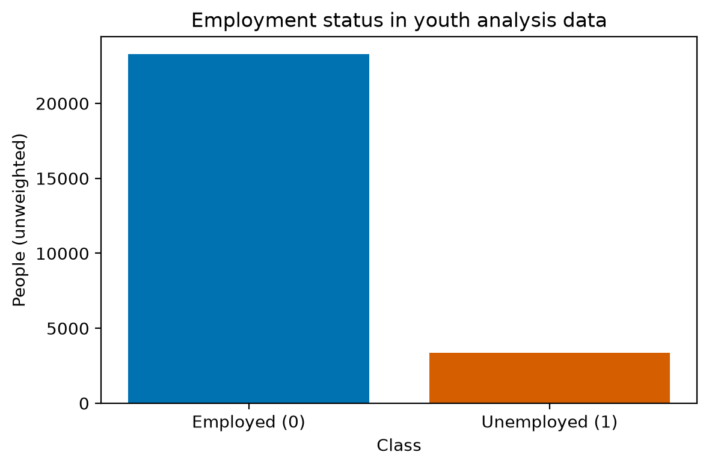
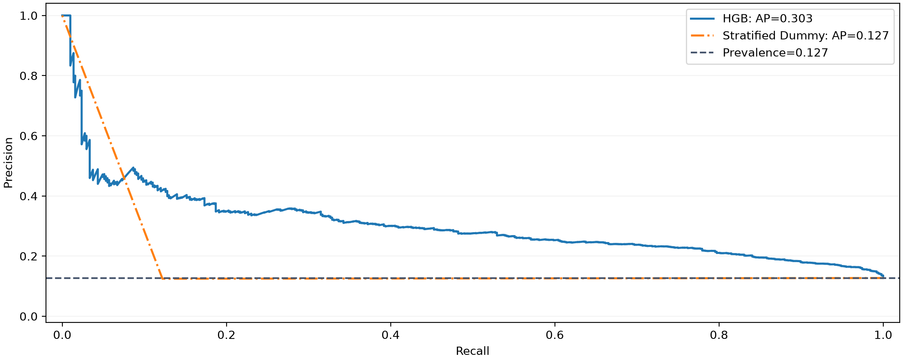
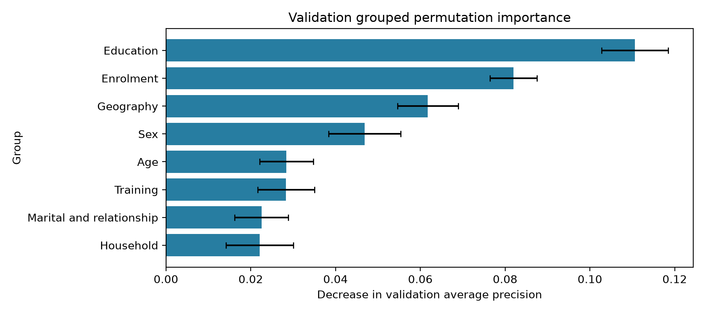
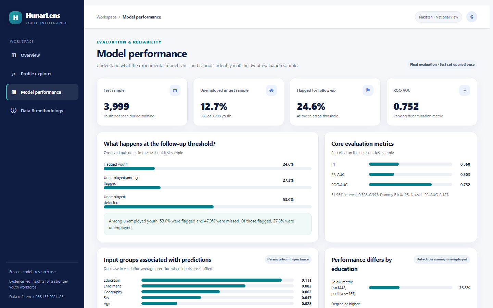

# HunarLens — submission report draft

**Draft for team review.** Pagination depends on typography, figure placement and appendices; verify the required length after export. Author names, contributions and AI-assistance disclosure are placeholders.

## Abstract

HunarLens examines unemployment among youth in the labour force using the Pakistan Labour Force Survey and contextual Census aggregates. A frozen histogram gradient boosting pipeline is evaluated against a stratified baseline. On the held-out sample, the primary F1 is 0.360 versus 0.123 for the baseline; average precision is 0.303 versus 0.127. A separate weighted skills-gap extension compares education and training as proxies and reports uncertainty. Results are associative, conditional on survey definitions and selection, and unsuitable for individual decisions.

## 1. Problem and motivation

Youth unemployment is a public-policy concern, but the unemployment rate is not the proportion of all young people without a job. It is conditioned on labour-force membership. People outside the labour force, including many students and unpaid carers, are not modelled as unemployed. HunarLens makes this denominator explicit and supports exploration of survey patterns and the performance of an experimental classifier.

The project asks two related but distinct questions. First, how well can permitted characteristics rank unemployment among labour-force youth? Second, how do education and vocational-training proxies vary with employment status and occupations? The second question is descriptive; the labour-force survey does not observe vacancies or direct employer requirements. Combining these questions on one dashboard requires visible separation between survey estimates, model output and official figures.

## 2. Importance and evidence

The [PBS Labour Force Statistics page](https://www.pbs.gov.pk/labour-force-statistics/) supplies the survey, questionnaire, methods and publications. The [ILO derivation guide](https://webapps.ilo.org/ilostat-files/LFS/ILO_PAPI_LFS_VARIABLE_DERIVATION_GUIDE%20%28A1V2%29.pdf) supplies international labour-force definitions. PBS reports unemployment with a specific reference period for search and availability. We reproduce published aggregates before modelling and present divergence where it exists.

Education mismatch can be described by an empirical occupational mode or by a normative occupation-to-education mapping. These answer different questions. The [ILOSTAT methodology](https://ilostat.ilo.org/blog/only-half-of-workers-worldwide-hold-jobs-corresponding-to-their-level-of-education/) and [ETF guidance](https://www.etf.europa.eu/en/publications-and-resources/publications/skills-mismatch-measurement-etf-partner-countries) explain alternative approaches. The automated ILOSTAT link check returned a non-success status; **VERIFY** browser access and source attribution before submission. NAVTTC/NSIS employer material is contextual, not a measurement of vacancies in this dataset; its link also requires **VERIFY**.

## 3. Solution design

### Architecture

PBS files are downloaded into an ignored raw directory and audited. The build script constructs the approved label, household roster features and regional lookup, and applies an explicit feature allowlist. Household-aware split assignments isolate the training, validation and test partitions. One scikit-learn pipeline performs feature engineering, missing-value handling, encoding and estimation. Validation supports threshold selection and explanations. The frozen artefact and metadata supply the Streamlit interface; tables and plots are precomputed rather than recomputed from test rows in the app.

The skills-gap path is separate. It uses audited survey variables, weights and PSU-cluster resampling for descriptive aggregates. The interface consumes only generated tables. Occupation and labour-force variables are never model predictors. A suitable architecture figure is a left-to-right flow from PBS data and audit to the separate model and skills paths, then to stored artefacts and the dashboard.

### Audiences and use

The dashboard supports students and researchers comparing aggregate patterns. The profile explorer illustrates how the frozen model responds to allowed inputs. It is not a screening service, a measure of personal ability or an employment decision tool. Counts, uncertainty and sample conditions must accompany comparisons; the interface is not evidence of causal effects.

## 4. Design decisions and rationale

| Decision | Choice | Alternative | Why | Evidence / file |
| --- | --- | --- | --- | --- |
| Label | Published headline concept with audited questionnaire routes; future starters use the available near-future proxy | Self-declared status or search alone | Reproduction and routing evidence | label_definition.md; label_reproduction.csv |
| Population | Youth in the labour force | All youth as model targets | Target is unemployment conditional on labour-force membership | label_definition.md |
| Predictors | Explicit demographic, education, household and Census allowlist | Outcome-related and identifier fields | Prevent leakage and protect privacy | ../src/hunarlens/config.py |
| Split | Stratified household groups | Random individual split | Avoid related records crossing partitions | ../reports/tables/split_summary.csv |
| Census join | Province with area where available | District matching | Verified geography; no unsupported district linkage | DECISIONS.md |
| Imbalance | Compare class weights; choose threshold on validation | Undersampling dependency | Avoid added dependency and report operating trade-offs | ../reports/tables/experiments.csv |
| Selection | HistGradientBoosting within the pre-agreed CV tie band | Highest-scoring random forest | Smaller train–CV gap, model size and prediction time; forest led held-out metrics | ../reports/tables/generalization_gap.csv |
| Calibration | Use raw probabilities | Sigmoid calibration | Validation calibration did not clearly improve | ../reports/tables/calibration_validation.csv |
| Threshold | Validation F1 plateau midpoint and separate screening threshold | A single noisy F1 peak | Improve stability and show recall trade-off | ../reports/tables/stage6_thresholds.csv |
| Test policy | Freeze before one test scoring | Repeated test-driven selection | Protect held-out evaluation | test_findings.md |
| Explanation | Grouped and individual permutation importance | Unapproved explanatory dependencies | Model-agnostic association and correlated-group interpretation | model_findings.md |
| Interface | Population context, uncertainty and non-decision wording | Individual verdict | Clarify sample and avoid prescriptive use | ../app/prototype.html |
| Skills gap | Weighted education/training proxies, mode norms and PSU intervals | Claiming direct skill demand | Survey records occupations, not vacancies or individual skills | skills_gap_methods.md |

Further detail, including gate approvals and alternatives, is recorded in [DECISIONS.md](DECISIONS.md). The future-starter timing requirement cannot be verified from the available survey fields, so the approved proxy is a documented approximation rather than proof of exact compliance for every case.

## 5. Data collection and preparation

The download manifest records source URLs, retrieval dates, bytes and SHA-256 checksums. [DATA_SOURCES.md](../DATA_SOURCES.md) lists every downloaded item and its status. PBS survey data are household-based; the Census tables supply aggregate regional context. Raw survey files remain outside version control. The approved label uses audited work, absence, job-search and availability fields, including an approved future-starter proxy. Ambiguous absence records are excluded in the recorded waterfall rather than silently discarded.

| step | rows |
| --- | --- |
| all survey records | 325445 |
| ambiguous absence code: after excluding S5C5=14 | 325428 |
| ambiguous absence code: after missing S5C5 where S5C4=1 | 325420 |
| age 10 and over | 230760 |
| age 15-24 after exclusions | 59486 |
| eligible employed or unemployed youth | 26653 |

The published all-age and youth reproduction comparisons are in [label_reproduction.csv](../reports/tables/label_reproduction.csv). The weighted youth unemployment estimate is 12.8%; it is not the same quantity as unweighted model prevalence. Household counts are assembled from roster fields before filtering youth. Only the final allowlist enters the model. Sensitive identifiers, household keys and labour-market outcome variables are not predictors. The census lookup is geographically coarse and adds no within-province variation in this build.

## 6. Exploratory data analysis

The EDA notebook examines class balance, age and household distributions, education and training categories, missingness, and numeric correlation. Group sizes are shown alongside descriptive rates. Plots use the modelling sample without survey weights, so they describe the records used for modelling rather than a population estimate. Patterns involving enrolment, sex and area are associations and can reflect selection into the labour force. Rare categories and missing-value codes are reviewed in the audit tables.



The chosen engineered fields include an ordered education representation alongside the original category, an age band, a household child share and clipping fitted on training rows. These transformations remain inside the pipeline. Grouped permutation and ablation results are used to interpret related education and geographic fields together, not as independent causal effects.

## 7. Methodology

### Splitting and preprocessing

Households are assigned to a single partition; grouped cross-validation prevents related youth from crossing folds. The modelling dataset uses an allowlist, median imputation and scaling for numeric features, and categorical imputation and unknown-safe one-hot encoding for categorical features. Transformations are fitted on training rows only. The saved partition sizes and prevalence are:

| split | rows | positives | prevalence |
| --- | --- | --- | --- |
| test | 3999 | 508 | 0.12703175793948487 |
| train | 18657 | 2368 | 0.12692287077236425 |
| val | 3997 | 507 | 0.1268451338503878 |

### Model development

The baseline is a stratified dummy classifier. Logistic regression, random forest and histogram gradient boosting are compared under grouped cross-validation using average precision. Validation is reserved for comparison, threshold selection and calibration review. A pre-agreed simplicity tie band permits the final model to be chosen for generalization gap, file size and prediction speed even when another candidate has a marginally higher CV score. The tuned train, CV and validation average-precision evidence is:

| model | train_ap | cv_ap | validation_ap | train_prevalence | val_prevalence | dummy_cv_ap | dummy_val_ap |
| --- | --- | --- | --- | --- | --- | --- | --- |
| logistic_regression | 0.28922503093667734 | 0.28106337590702485 | 0.2811658875057954 | 0.12692287077236425 | 0.1268451338503878 | 0.12603114794509057 | 0.1265887396490224 |
| random_forest | 0.4731514089274343 | 0.30760883990012833 | 0.32773439776363034 | 0.12692287077236425 | 0.1268451338503878 | 0.12603114794509057 | 0.1265887396490224 |
| hist_gradient_boosting | 0.4013558913982467 | 0.29770504942258913 | 0.3123126689769751 | 0.12692287077236425 | 0.1268451338503878 | 0.12603114794509057 | 0.1265887396490224 |

Calibration review retained raw probabilities. The primary operating point is selected on validation from a near-optimal F1 range, while the secondary screening point seeks higher recall. Both thresholds were fixed before test scoring. Model-specific explanations use permutation importance on validation; correlated inputs are also permuted as groups. The approach measures how much the model relies on information under the chosen evaluation scheme, not a causal effect.

### Skills-gap estimates

Survey descriptions use weights and PSU-cluster bootstrap intervals; they do not reproduce the full stratified survey design. Occupation modes are recomputed in bootstrap resamples for statistical mismatch estimates. The strict, within-one-band, severe and normative definitions are reported separately. Unstable modes and wide ranges are flagged. Small cells are suppressed according to the approved disclosure rule; structural zeros are distinguished from observed small counts.

## 8. Results

### Final test and baseline

The sealed evaluation reports the following metrics. Values are unweighted and the two model thresholds use the same frozen probabilities. The test predictions are not regenerated for this document.

| model_threshold | n | positives | prevalence | f1 | precision | recall | pr_auc | roc_auc | lift_10 |
| --- | --- | --- | --- | --- | --- | --- | --- | --- | --- |
| HGB F1 | 3999 | 508 | 0.127 | 0.360 | 0.273 | 0.530 | 0.303 | 0.752 | 2.814 |
| HGB screening | 3999 | 508 | 0.127 | 0.354 | 0.247 | 0.628 | 0.303 | 0.752 | 2.814 |
| Stratified Dummy | 3999 | 508 | 0.127 | 0.123 | 0.125 | 0.122 | 0.127 | 0.499 | 0.866 |

The household-bootstrap interval for primary F1 is 0.328–0.393. It expresses sampling variability under this resampling design, not a guarantee of performance elsewhere. The precision–recall baseline is the test prevalence. The associated curve and confusion matrix are in the [figure index](report_figures.md). See [test_findings.md](test_findings.md) for precision, recall, lift, errors and caveats.



### Subgroup performance

| subgroup | value | n | positives | precision | recall |
| --- | --- | --- | --- | --- | --- |
| sex | Female | 909 | 125 | 0.348 | 0.680 |
| sex | Male | 3090 | 383 | 0.248 | 0.480 |
| area | Rural | 2840 | 321 | 0.284 | 0.498 |
| area | Urban | 1159 | 187 | 0.259 | 0.583 |

Subgroup results are descriptive. Sample size and the number of positive cases affect stability; some education and geography groups have fewer positive cases than the reliability threshold. Differences do not establish that an attribute caused an outcome. The classifier uses sex and location, so model use and group error rates require explicit fairness review.



### Skills-gap results

The weighted unemployment comparison below is conditional on labour-force membership and should not be compared directly with unweighted model metrics:

| category | n | positive_n | estimate | ci_low | ci_high |
| --- | --- | --- | --- | --- | --- |
| No formal | 7094 | 617 | 8.2% | 7.3% | 9.0% |
| Below matric | 9629 | 1080 | 11.4% | 10.6% | 12.2% |
| Matric | 4574 | 679 | 14.8% | 13.7% | 16.0% |
| Intermediate | 3849 | 664 | 17.5% | 16.1% | 19.1% |
| Degree or above | 1507 | 343 | 22.6% | 20.3% | 25.0% |

Degree-level labour-force outcomes, weighted shares:

| category | n | positive_n | estimate | ci_low | ci_high |
| --- | --- | --- | --- | --- | --- |
| Employed: groups 1–4 | 1507 | 624 | 0.41985752673876653 | 0.3933632167886693 | 0.44653095413680777 |
| Employed: groups 5–9 | 1507 | 540 | 0.3537132478199857 | 0.32974475751286086 | 0.3785800070593894 |
| Unemployed | 1507 | 343 | 0.2264292254412478 | 0.20264977152158695 | 0.25045985436910856 |

Strict above-mode or above-norm shares, with denominator and cell counts:

| group | category | n | positive_n | estimate | ci_low | ci_high |
| --- | --- | --- | --- | --- | --- | --- |
| overall; norm=all_15_plus | over | 23270 | 10516 | 0.45964895486773316 | 0.44977349596219846 | 0.4722710368648317 |
| overall; norm=age_25_44 | over | 23270 | 10516 | 0.45964895486773316 | 0.4481518894759944 | 0.4686944589380154 |
| overall; norm=youth | over | 23270 | 9364 | 0.4104623596935751 | 0.3114768843191268 | 0.4164365224913014 |
| overall; norm=ISCO | over | 23270 | 2378 | 0.10599071077749496 | 0.10111938498281775 | 0.1110157577083931 |

Tolerance and severe variants use different definitions and should not be combined into a single range:

| group | category | n | positive_n | estimate | ci_low | ci_high |
| --- | --- | --- | --- | --- | --- | --- |
| all_15_plus | within one band | 23270 | 17696 | 0.7567689795726827 | 0.7483462916466681 | 0.7648338735652408 |
| all_15_plus | two or more bands above | 23270 | 4545 | 0.19799345887595254 | 0.19096647851568976 | 0.20776293249314404 |
| age_25_44 | within one band | 23270 | 17696 | 0.7567689795726827 | 0.7483006088891452 | 0.7673940119527326 |
| age_25_44 | two or more bands above | 23270 | 4545 | 0.19799345887595254 | 0.18805499234854955 | 0.20568194943244553 |
| youth | within one band | 23270 | 18741 | 0.8030112777440813 | 0.7956379520352435 | 0.8454011183800605 |
| youth | two or more bands above | 23270 | 3991 | 0.17390743201362693 | 0.12879816310370099 | 0.17904162480071484 |

The training comparison below is the unemployed-minus-employed difference in weighted shares:

| group | category | employed_n | unemployed_n | difference | ci_low | ci_high | flag |
| --- | --- | --- | --- | --- | --- | --- | --- |
| overall | Training ever/current | 23270 | 3383 | -0.08875280174069138 | -0.10289317768427475 | -0.07484139879307698 |  |

The approximate not-employed-and-not-enrolled measure and the separate PBS reference are:

| group | category | n | positive_n | estimate | ci_low | ci_high | flag |
| --- | --- | --- | --- | --- | --- | --- | --- |
| overall | not employed and not enrolled | 59486 | 18007 | 0.2929983417484323 | 0.28721919340816227 | 0.29847226605521504 |  |

| indicator | estimate | n | ci_low | ci_high | source_url | source |
| --- | --- | --- | --- | --- | --- | --- |
| PBS NEET youth 2024-25, all areas | 0.284 | not reported in table | not reported | not reported | https://www.pbs.gov.pk/wp-content/uploads/2020/07/LFS-2024-25-Annual-Report.pdf | PBS Annual Report, Table 8.8 |

Our approximation cannot identify recent training and is not the complete SDG NEET indicator. The occupation-mode estimates depend on the education-band scheme and composition of occupations. The age-specific adult norm happens to produce the same point modes as the all-employed norm, so it is not an independent point-estimate sensitivity. [Skills-gap findings](skills_gap_findings.md) and [sign-off](skills_gap_signoff.md) contain the complete results, counts, bootstrap ranges, sensitivity definitions and caveats.

## 9. Deployment and interface

The application runs as a Streamlit service and reads a frozen model, metadata and tracked aggregate artefacts. It contains overview, skills-gap, profile, performance and methodology views. A native Streamlit fallback is available when the custom component is unavailable. Inputs are transient and are not intentionally stored. Screenshots of the desktop interface and skills page are linked in [report_figures.md](report_figures.md). **VERIFY** the deployed branch, URL and live rendering with the team before submission.




## 10. Limitations and future work

The model is conditional on labour-force membership, uses unweighted survey records and is not externally validated. Future-starter timing cannot be verified. Census information is aggregate and geographically coarse. Education and training proxy skills only imperfectly; a worker's qualification does not establish task proficiency. Occupation information exists for employed youth and employer demand is absent. PSU bootstrap intervals ignore stratification; model bootstrap intervals describe a different sampling procedure. Group comparisons may be imprecise or unstable, and repeated development decisions can affect generalization.

Future work includes independent temporal or external validation, an explicit survey-design analysis, fairness assessment with adequate subgroup sizes, independently sourced employer demand, and confirmation of licences and report references. The current artefact is for exploratory aggregate research rather than individual decisions.

## References

- Pakistan Bureau of Statistics. Labour Force Survey, questionnaire, coding scheme, annual report and Census tables. See [DATA_SOURCES.md](../DATA_SOURCES.md) for source URLs, dates and checksums.
- International Labour Organization. Labour-force variable derivation guide. [Guide](https://webapps.ilo.org/ilostat-files/LFS/ILO_PAPI_LFS_VARIABLE_DERIVATION_GUIDE%20%28A1V2%29.pdf).
- ILOSTAT. Educational mismatch methods. [Methodology](https://ilostat.ilo.org/blog/only-half-of-workers-worldwide-hold-jobs-corresponding-to-their-level-of-education/) — **VERIFY** automated access.
- European Training Foundation. [Skills mismatch measurement](https://www.etf.europa.eu/en/publications-and-resources/publications/skills-mismatch-measurement-etf-partner-countries).
- NAVTTC / NSIS. [Skills information](https://www.skillingpakistan.gov.pk/) — **VERIFY** automated access and survey-year attribution.
- NAVTTC / NSIS. [Skills Trend Analysis](https://tevtreform.jobs.gov.pk/wp-content/uploads/downloads/governance/Skills%20Trend%20Analysis.pdf), n.d. — external context; **VERIFY** publication year and access.

## Individual contributions — placeholders

| Team member | Contribution | Evidence / review |
|---|---|---|
| [NAME — COMPLETE] | [COMPLETE] | [COMPLETE] |
| [NAME — COMPLETE] | [COMPLETE] | [COMPLETE] |
| [NAME — COMPLETE] | [COMPLETE] | [COMPLETE] |

## Appendix A. Tables and uncertainty

Full aggregate CSVs are under `reports/tables/`; the [skills sign-off](skills_gap_signoff.md), [test findings](test_findings.md), and [source catalogue](../DATA_SOURCES.md) link the tables to definitions. The source workbook and raw microdata are not included. The figures list identifies the approved report images.

### Unemployment by education and available sex and area groups

| group | category | n | positive_n | estimate | ci_low | ci_high | flag | labour_force_n | unemployed_n |
| --- | --- | --- | --- | --- | --- | --- | --- | --- | --- |
| overall | No formal | 7094 | 617 | 0.08151698209834193 | 0.07266397225375698 | 0.09036668542640944 |  | 7094 | 617 |
| overall | Below matric | 9629 | 1080 | 0.11412785088228714 | 0.10621096391577767 | 0.12242097568670464 |  | 9629 | 1080 |
| overall | Matric | 4574 | 679 | 0.14838004365558388 | 0.13678739087003697 | 0.15986162244657395 |  | 4574 | 679 |
| overall | Intermediate | 3849 | 664 | 0.175061463522163 | 0.1605064083976515 | 0.19061444672975078 |  | 3849 | 664 |
| overall | Degree or above | 1507 | 343 | 0.2264292254412478 | 0.20264977152158695 | 0.25045985436910856 |  | 1507 | 343 |
| sex=1.0 | No formal | 4669 | 468 | 0.09218967138777064 | 0.08136883018234703 | 0.10337583655562307 |  | 4669 | 468 |
| sex=1.0 | Below matric | 8076 | 925 | 0.11667680724594667 | 0.10768785662144532 | 0.1257762857962374 |  | 8076 | 925 |
| sex=1.0 | Matric | 3856 | 529 | 0.1392598887796819 | 0.12640645709736065 | 0.15326747412462666 |  | 3856 | 529 |
| sex=1.0 | Intermediate | 2916 | 439 | 0.15396375223987768 | 0.13869336136395932 | 0.16948787101754267 |  | 2916 | 439 |
| sex=1.0 | Degree or above | 913 | 176 | 0.18582552573418765 | 0.1582275781087812 | 0.21387982574073927 |  | 913 | 176 |
| sex=2.0 | No formal | 2425 | 149 | 0.0614619602869308 | 0.04879760736036639 | 0.07559810720099092 |  | 2425 | 149 |
| sex=2.0 | Below matric | 1553 | 155 | 0.1012004250378947 | 0.08460054331282905 | 0.11943781038309506 |  | 1553 | 155 |
| sex=2.0 | Matric | 718 | 150 | 0.19533884163268259 | 0.16322811564117273 | 0.22762746578320867 |  | 718 | 150 |
| sex=2.0 | Intermediate | 933 | 225 | 0.23507071856736492 | 0.20340936294830764 | 0.26659544627325626 |  | 933 | 225 |
| sex=2.0 | Degree or above | 594 | 167 | 0.2843083984477464 | 0.24471817233881746 | 0.3201896745713242 |  | 594 | 167 |
| area=1.0 | No formal | 5986 | 494 | 0.07389715137777098 | 0.06442810704569539 | 0.08357686026811136 |  | 5986 | 494 |
| area=1.0 | Below matric | 7212 | 719 | 0.09775954355287256 | 0.08949265112570189 | 0.10635903060896404 |  | 7212 | 719 |
| area=1.0 | Matric | 3129 | 456 | 0.14568930472669997 | 0.13142762932051144 | 0.16103580061755532 |  | 3129 | 456 |
| area=1.0 | Intermediate | 2505 | 413 | 0.17023538298105367 | 0.15216913939839477 | 0.18813430429446124 |  | 2505 | 413 |
| area=1.0 | Degree or above | 837 | 198 | 0.24124896751086713 | 0.2091380285635136 | 0.27178357940559533 |  | 837 | 198 |
| area=2.0 | No formal | 1108 | 123 | 0.1128797447713941 | 0.08947472690193126 | 0.13711922056330547 |  | 1108 | 123 |
| area=2.0 | Below matric | 2417 | 361 | 0.15150359535012645 | 0.134886453635012 | 0.1691668756355383 |  | 2417 | 361 |
| area=2.0 | Matric | 1445 | 223 | 0.15293057126722273 | 0.13082456155999586 | 0.17575495532919924 |  | 1445 | 223 |
| area=2.0 | Intermediate | 1344 | 251 | 0.1821261001840908 | 0.15557244800470876 | 0.2091103167687406 |  | 1344 | 251 |
| area=2.0 | Degree or above | 670 | 145 | 0.21178099178621643 | 0.17563890149596423 | 0.24568170634045894 |  | 670 | 145 |

### Mismatch by occupation and reference norm

| group | category | n | positive_n | estimate | ci_low | ci_high | flag | reliability | bootstrap_median | bootstrap_bias |
| --- | --- | --- | --- | --- | --- | --- | --- | --- | --- | --- |
| all_15_plus | occupation 1 | 239 | 0 | — | — | — | structural zero |  |  |  |
| all_15_plus | occupation 2 | 1248 | 0 | — | — | — | structural zero |  |  |  |
| all_15_plus | occupation 3 | 710 | 0 | — | — | — | structural zero |  |  |  |
| all_15_plus | occupation 4 | 269 | 0 | — | — | — | structural zero |  |  |  |
| all_15_plus | occupation 5 | 4201 | 1910 | 0.46148181853378234 | 0.4418749195532614 | 0.4812058243717906 |  |  | 0.4612415333984582 | -0.00024028513532414753 |
| all_15_plus | occupation 6 | 6811 | 4058 | 0.6341872265882863 | 0.6124438595632762 | 0.6560751419747187 |  |  | 0.6349112177296237 | 0.0007239911413373656 |
| all_15_plus | occupation 7 | 3511 | 996 | 0.29049343073699857 | 0.27182767178992284 | 0.31008895235857237 |  |  | 0.2903278399980915 | -0.00016559073890709541 |
| all_15_plus | occupation 8 | 1600 | 514 | 0.3206657618624877 | 0.2946592653167894 | 0.3476747008024484 |  |  | 0.3200727893771407 | -0.0005929724853470097 |
| all_15_plus | occupation 9 | 4681 | 3038 | 0.6672401159511342 | 0.6498668786220525 | 0.6867800275995735 |  |  | 0.6677820332735583 | 0.0005419173224241458 |
| age_25_44 | occupation 1 | 239 | 0 | — | — | — | structural zero |  |  |  |
| age_25_44 | occupation 2 | 1248 | 0 | — | — | — | structural zero |  |  |  |
| age_25_44 | occupation 3 | 710 | 0 | — | — | — | structural zero |  |  |  |
| age_25_44 | occupation 4 | 269 | 0 | — | — | — | structural zero |  |  |  |
| age_25_44 | occupation 5 | 4201 | 1910 | 0.46148181853378234 | 0.4418749195532614 | 0.4812058243717906 |  |  | 0.4612415333984582 | -0.00024028513532414753 |
| age_25_44 | occupation 6 | 6811 | 4058 | 0.6341872265882863 | 0.6124438595632762 | 0.6560751419747187 |  |  | 0.6349112177296237 | 0.0007239911413373656 |
| age_25_44 | occupation 7 | 3511 | 996 | 0.29049343073699857 | 0.27182767178992284 | 0.31008895235857237 |  |  | 0.2903278399980915 | -0.00016559073890709541 |
| age_25_44 | occupation 8 | 1600 | 514 | 0.3206657618624877 | 0.2946592653167894 | 0.3476747008024484 |  |  | 0.3200727893771407 | -0.0005929724853470097 |
| age_25_44 | occupation 9 | 4681 | 3038 | 0.6672401159511342 | 0.645415036548906 | 0.6856635688293988 |  |  | 0.6675161939388066 | 0.000276077987672374 |
| youth | occupation 1 | 239 | 143 | 0.6189314758769404 | 0.0 | 0.6382433400320597 |  | mode unstable | 0.3722948853903373 | -0.24663659048660314 |
| youth | occupation 2 | 1248 | 386 | 0.3125966586270619 | 0.2829844941879221 | 0.3397651241338784 |  |  | 0.31283980108659337 | 0.00024314245953149793 |
| youth | occupation 3 | 710 | 130 | 0.18253327902449565 | 0.1528011525425858 | 0.2136320613921977 |  |  | 0.18228882125417603 | -0.00024445777031961713 |
| youth | occupation 4 | 269 | 60 | 0.231829691073057 | 0.17833680095551382 | 0.2842468710776371 |  |  | 0.23275603064227443 | 0.0009263395692174214 |
| youth | occupation 5 | 4201 | 1910 | 0.46148181853378234 | 0.4418749195532614 | 0.4812058243717906 |  |  | 0.4612415333984582 | -0.00024028513532414753 |
| youth | occupation 6 | 6811 | 4058 | 0.6341872265882863 | 0.2862308985898464 | 0.6473235939994266 |  | mode unstable | 0.6307505116388608 | -0.0034367149494255456 |
| youth | occupation 7 | 3511 | 996 | 0.29049343073699857 | 0.27182767178992284 | 0.31008895235857237 |  |  | 0.2903278399980915 | -0.00016559073890709541 |
| youth | occupation 8 | 1600 | 514 | 0.3206657618624877 | 0.2946592653167894 | 0.3476747008024484 |  |  | 0.3200727893771407 | -0.0005929724853470097 |
| youth | occupation 9 | 4681 | 1167 | 0.2572722251640501 | 0.24217713384992717 | 0.27531185158296145 |  |  | 0.25729993558538 | 2.7710421329929513e-05 |
| ISCO | occupation 1 | 239 | 0 | — | — | — | structural zero |  |  |  |
| ISCO | occupation 2 | 1248 | 0 | — | — | — | structural zero |  |  |  |
| ISCO | occupation 3 | 710 | 0 | — | — | — | structural zero |  |  |  |
| ISCO | occupation 4 | 269 | 60 | 0.231829691073057 | 0.17969531748562242 | 0.2842468710776371 |  |  |  |  |
| ISCO | occupation 5 | 4201 | 187 | 0.04418256761574129 | 0.03690761604146025 | 0.05168975653229663 |  |  |  |  |
| ISCO | occupation 6 | 6811 | 141 | 0.024702795826650664 | 0.020553502734044545 | 0.02962170768318966 |  |  |  |  |
| ISCO | occupation 7 | 3511 | 66 | 0.019136698387813112 | 0.014411939512997414 | 0.024215488032877923 |  |  |  |  |
| ISCO | occupation 8 | 1600 | 40 | 0.024346298897968237 | 0.016466987990897963 | 0.03285458357824819 |  |  |  |  |
| ISCO | occupation 9 | 4681 | 1884 | 0.41457679808524206 | 0.39698061572396004 | 0.4339455481354324 |  |  |  |  |

### Test subgroup table

| subgroup | value | threshold | n | positives | unreliable_fewer_than_50_positives | flag_rate | precision | recall |
| --- | --- | --- | --- | --- | --- | --- | --- | --- |
| sex | Female | f1 | 909 | 125 | False | 0.2684268426842684 | 0.3483606557377049 | 0.68 |
| sex | Female | screening | 909 | 125 | False | 0.29592959295929594 | 0.3382899628252788 | 0.728 |
| sex | Male | f1 | 3090 | 383 | False | 0.23980582524271846 | 0.2483130904183536 | 0.4804177545691906 |
| sex | Male | screening | 3090 | 383 | False | 0.33171521035598706 | 0.2224390243902439 | 0.5953002610966057 |
| area | Rural | f1 | 2840 | 321 | False | 0.19859154929577466 | 0.28368794326241137 | 0.4984423676012461 |
| area | Rural | screening | 2840 | 321 | False | 0.27147887323943665 | 0.2438391699092088 | 0.5856697819314641 |
| area | Urban | f1 | 1159 | 187 | False | 0.363244176013805 | 0.2589073634204275 | 0.5828877005347594 |
| area | Urban | screening | 1159 | 187 | False | 0.451251078515962 | 0.25047801147227533 | 0.7005347593582888 |
| sex_area | Female / Rural | f1 | 712 | 73 | False | 0.175561797752809 | 0.32 | 0.547945205479452 |
| sex_area | Female / Rural | screening | 712 | 73 | False | 0.20224719101123595 | 0.3055555555555556 | 0.6027397260273972 |
| sex_area | Female / Urban | f1 | 197 | 52 | False | 0.6040609137055838 | 0.37815126050420167 | 0.8653846153846154 |
| sex_area | Female / Urban | screening | 197 | 52 | False | 0.6345177664974619 | 0.376 | 0.9038461538461539 |
| sex_area | Male / Rural | f1 | 2128 | 248 | False | 0.206296992481203 | 0.2733485193621868 | 0.4838709677419355 |
| sex_area | Male / Rural | screening | 2128 | 248 | False | 0.29464285714285715 | 0.22966507177033493 | 0.5806451612903226 |
| sex_area | Male / Urban | f1 | 962 | 135 | False | 0.31392931392931395 | 0.2119205298013245 | 0.4740740740740741 |
| sex_area | Male / Urban | screening | 962 | 135 | False | 0.41372141372141374 | 0.21105527638190955 | 0.6222222222222222 |
| province | Balochistan | f1 | 388 | 35 | True | 0.31443298969072164 | 0.2459016393442623 | 0.8571428571428571 |
| province | Balochistan | screening | 388 | 35 | True | 0.37628865979381443 | 0.2191780821917808 | 0.9142857142857143 |
| province | Khyber Pakhtunkhwa | f1 | 680 | 107 | False | 0.2838235294117647 | 0.2538860103626943 | 0.45794392523364486 |
| province | Khyber Pakhtunkhwa | screening | 680 | 107 | False | 0.35441176470588237 | 0.24896265560165975 | 0.5607476635514018 |
| province | Punjab | f1 | 1966 | 260 | False | 0.2278738555442523 | 0.29464285714285715 | 0.5076923076923077 |
| province | Punjab | screening | 1966 | 260 | False | 0.3046795523906409 | 0.2637729549248748 | 0.6076923076923076 |
| province | Sindh | f1 | 965 | 106 | False | 0.23005181347150258 | 0.26126126126126126 | 0.5471698113207547 |
| province | Sindh | screening | 965 | 106 | False | 0.31917098445595854 | 0.22402597402597402 | 0.6509433962264151 |
| education_group | Below matric | f1 | 1442 | 167 | False | 0.1636615811373093 | 0.2584745762711864 | 0.3652694610778443 |
| education_group | Below matric | screening | 1442 | 167 | False | 0.24895977808599168 | 0.23676880222841226 | 0.5089820359281437 |
| education_group | Degree or higher | f1 | 208 | 46 | True | 0.6442307692307693 | 0.30597014925373134 | 0.8913043478260869 |
| education_group | Degree or higher | screening | 208 | 46 | True | 0.7115384615384616 | 0.2972972972972973 | 0.9565217391304348 |
| education_group | Intermediate | f1 | 617 | 101 | False | 0.49432739059967584 | 0.3114754098360656 | 0.9405940594059405 |
| education_group | Intermediate | screening | 617 | 101 | False | 0.5316045380875203 | 0.29573170731707316 | 0.9603960396039604 |
| education_group | Matric | f1 | 694 | 99 | False | 0.33285302593659943 | 0.23809523809523808 | 0.5555555555555556 |
| education_group | Matric | screening | 694 | 99 | False | 0.46253602305475505 | 0.2118380062305296 | 0.6868686868686869 |
| education_group | No formal education | f1 | 1038 | 95 | False | 0.07610789980732177 | 0.21518987341772153 | 0.17894736842105263 |
| education_group | No formal education | screening | 1038 | 95 | False | 0.1329479768786127 | 0.18115942028985507 | 0.2631578947368421 |

## Appendix B. Frozen hyperparameters

```json
{
  "max_iter": 200,
  "learning_rate": 0.06,
  "max_depth": null,
  "max_leaf_nodes": 15,
  "min_samples_leaf": 50,
  "l2_regularization": 10,
  "early_stopping": false,
  "class_weight": null,
  "random_state": 42
}
```

The saved thresholds and versions are in [metadata.json](../models/metadata.json). The trained artefact is not regenerated to write this report.

## Appendix C. Test inventory

The `tests/` directory covers data and label reproduction, grouping, pipeline leakage, experiments, freeze, explainability, sealed test artefacts, application parity, the skills audit, disclosure, bootstrap and dashboard. Run `python -m pytest -q` for the default suite and `python -m pytest -q -m full_data` for full-data checks when the ignored local data are available. Tests are not evidence of future live-service performance.
